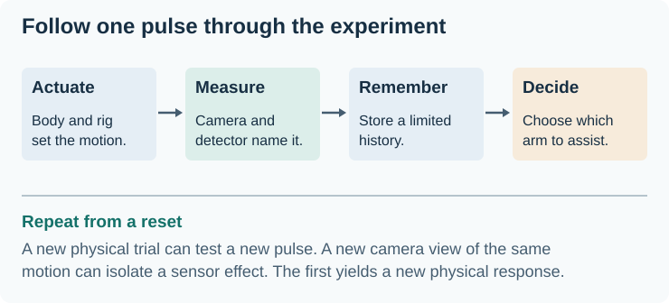

# What a world model needs to know about left and right

A robot gives both arms the same pulse. Its left arm appears to move farther. An engineer has at least four decisions to make. Is the difference worth remembering for a later command? Which observed track belongs to the physical left arm? Would the difference persist on a balanced rig with a calibrated camera? Which experiment would reveal a departure from symmetry before testing time runs out? Each question has a different answer even when all four use the same video.

A *world model* predicts what a system will do following an action. A *reflection-equivariant* world model transforms its prediction consistently when the entire physical experiment is mirrored, including the action, the body and any sided equipment. An *invariant* quantity stays the same under that operation. An *odd* quantity, such as left-minus-right displacement in body coordinates, changes sign. An odd feature may encode a weak actuator, the current phase of an alternating gait, or a camera distortion. Its sign alone cannot tell the engineer which repair to make. Architectural precedents include chirality-aware pose networks, state-action symmetries in control and a reflection-equipped robot world model. [Yeh et al., NeurIPS 2019](https://proceedings.neurips.cc/paper/2019/hash/1f88c7c5d7d94ae08bd752aa3d82108b-Abstract.html) · [van der Pol et al., NeurIPS 2020](https://proceedings.neurips.cc/paper/2020/hash/2be5f9c2e3620eb73c2972d7552b6cb5-Abstract.html) · [Lan et al., SWAP](https://arxiv.org/abs/2606.19928)

*The same pulse connects the four proposals. Changing a camera can change the recorded response while leaving the trajectory intact. Changing the physical load requires another run. Choosing a later command can require information that has already disappeared from view.*

## Four proposals, four decisive comparisons

| Proposal | What the first experiment can establish | Comparison that could overturn the learning claim |
|---|---|---|
| [1. Remembering which side to actuate](01_preserve_interventional_information.md) | The cost of merging two histories whose best future commands differ, and when a bit is better spent on gait phase. | Can a codec trained directly on action losses, or an unrestricted search with the same rollout budget, match reflection-guided memory allocation? |
| [2. Tracking physical side](02_track_physical_side.md) | The exact value of a delayed side marker when the detector may have switched names in the meantime. | Does reflection sharing improve signed forecasts over an untied switching model that already keeps both assignments alive? |
| [3. Separating the body from the apparatus](03_separate_body_and_apparatus.md) | Which equipment reversals identify the neutral body response, even if separate apparatus effects remain uncertain. | Do calibrated contrasts or an ordinary contextual model reach the same response accuracy with as few independent runs? |
| [4. Designing experiments under a deadline](04_design_experiments_with_valid_evidence.md) | Which sequences of probes detect a broken input-output symmetry within a fixed budget. | Does the learned planner improve detection against equally far-sighted information design and model-free active testing at the same physical cost? |

The proposals make different uses of repeated observations. In Proposal 1, comparing two histories exposes the price of a particular compression decision. A useful comparison can still lead to a poor global allocation of bits. In Proposal 2, the association between an unknown sign and an unknown detector assignment is itself worth remembering. Both marginal beliefs can look uninformative before a physical marker arrives. Together they explain why decoding an anatomical label from an individual frame gives an incomplete assessment of a representation.

Proposals 3 and 4 ask what experiment can support a conclusion about a physical system. In Proposal 3, opposing rig settings can cancel a nuisance or hide an interaction, depending on the measurement law. In Proposal 4, a randomized, resettable sequence tests whether measured responses respect reflection. A rejection can motivate the crossed experiment in Proposal 3. Establishing anatomical weakness requires its extra information. Conversely, Proposal 3's apparatus and sensor controls can help justify the reflection null in Proposal 4.

## Where to begin

**Start with the crossed actuator experiment in Proposal 3 and the exact naming filter in Proposal 2.** The former has a physical target that can be sealed for evaluation and a simple case where unlimited data on the wrong settings never recover it. The latter is the shortest route to a calibrated answer about information loss and shows how to compute a raw-history reference under Proposal 1’s own dynamics and loss. Proposal 1 merits a parallel CPU pilot when its decision gap is large enough to verify with the planned rollout budget. These priorities are judgments about what can be learned cheaply, conditional on access to resettable simulators.

**Proposal 4 has the strongest reason to start with a table rather than a large model.** In its specified two-pulse system, choosing each pulse for immediate expected log evidence detects asymmetry in 80.1% of sequences by trial 12. The policy that plans explicitly for that deadline reaches 95.1% and spends more trials on average. These are calculated probabilities for known channels. A learned policy still has to earn its advantage over an equally informed planner or a rule that explores the pulses directly.

Across the four studies, hold out complete physical bodies, keep every rendering or reflection of a trajectory in the same split, and record whether each method sees measured outcomes, hidden simulator labels or a fitted predictor. An exact decision from raw observable history sets a different ceiling from a decision given hidden parameters. Use paired comparisons across test bodies and independent training seeds. Frames, views and consecutive time steps share information. Report them as repeated measurements. Begin with small, enumerable CPU systems and use the Stanford HAIC H100s for the gated neural comparisons. Pilot hour caps in the individual proposals are planning choices. Actual throughput, queue access and empirical precision remain to be measured.

The [source studies](06_sources.md) trace all 44 original papers and the additional work that changed the designs. The [review and revision record](05_adversarial_review.md) gives the objections, resolved checks and remaining questions. The algebraic examples have been checked. The proposed learning studies have yet to run.
