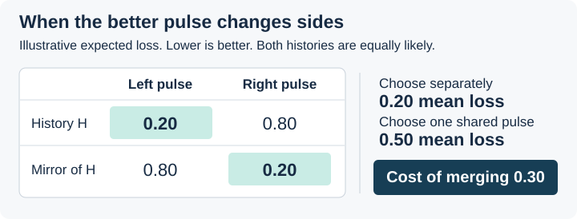
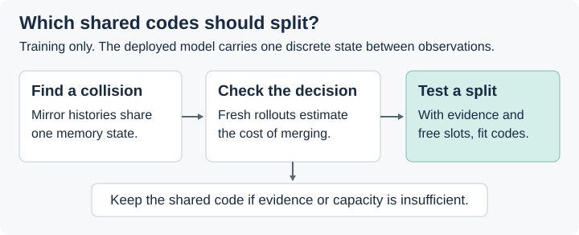

# Remembering which side to actuate

**Research question.** At a fixed memory capacity and rollout budget, can comparing mirrored histories help a world model remember which actuator to use after an early calibration signal has faded?

A short calibration movement reveals which of a robot’s two arms transfers force more effectively. Several seconds of symmetric motion follow. Predicting those frames rewards remembering the phase. Choosing which arm to pulse later may depend entirely on the earlier calibration movement.

**Hypothesis.** Looking for a history and its physical mirror should help a learner find cases where forgetting side changes the best command. The predicted benefit is lower action loss at matched budgets, especially when informative calibration signals are observable but consequential side-specific choices are rare.

## What counts as losing useful information?

Let $H$ be the observations and commands available up to decision time, and let $MH$ describe the reflected experiment. The reflection exchanges arms, reflects their coordinates, and transforms earlier commands and any asymmetric surroundings. At query time both histories face the same menu of anatomically registered commands. Let $L_h(a)$ be the expected loss, scaled to $[0,1]$, of command $a$ following observable history $h$, for example the probability that a correction misses its target. A *witness* is a pair of histories that the memory merges even though being able to distinguish them would improve the decision.

For an equally weighted pair and a fixed menu, the best shared command incurs an excess loss

$$
W(H)=
\min_a \frac{L_H(a)+L_{MH}(a)}{2}
-\frac{\min_a L_H(a)+\min_a L_{MH}(a)}{2}.
$$

The first minimum chooses one command for both histories. The second term chooses separately. An entire trajectory can change under reflection while $W(H)$ stays zero if both histories share an optimal command. A coded state may merge many histories, so a positive pair gap gives a local reason to test a split.

*Figure 1. The highlighted entries are the best choices using each history. Sharing a memory state forces a common decision when the same query is presented. These numbers illustrate the identity above.*

## From a useful test to a finite memory

Suppose two successive observations reveal a fair binary gain sign and an independent fair phase. After both disappear, the controller learns which decision it faces. With probability $q$ it must choose the stronger side. Otherwise it must advance or delay a pulse according to phase. Wrong choices cost one. The full history has zero loss. A one-bit codec can implement any of the 16 binary encodings of the four histories by first storing the sign and then updating on phase. Choosing the majority answer within each code for each query and enumerating the 16 tables gives minimum loss $\min(q,1-q)/2$. Storing the more frequently requested bit attains it, including at $q=0,1/2,1$. A genuine side witness can therefore recommend a split that makes a one-bit controller worse.

Several earlier methods suggest ways to decide what to keep. Predictive state representations describe a system by what it would do after future actions. Value-equivalent sampling bounds the expected loss from learning a coarser model of an environment. The deficiency bottleneck relates compression to excess log loss. Counterexample-guided abstraction refinement tests a proposed state merger and splits it when a verified example exposes a failure. The object to compress here is the history available within one episode. [Littman et al., *Predictive Representations of State*](https://proceedings.neurips.cc/paper_files/paper/2001/file/1e4d36177d71bbb3558e43af9577d70e-Paper.pdf) · [Arumugam and Van Roy, *Deciding What to Model*](https://proceedings.neurips.cc/paper_files/paper/2022/hash/3b18d368150474ac6fc9bb665d3eb3da-Abstract-Conference.html) · [Banerjee and Montúfar, *The Variational Deficiency Bottleneck*](https://arxiv.org/abs/1810.11677) · [Chadha and Viswanathan, ACM TOCL 2010, *A Counterexample-Guided Abstraction-Refinement Framework for Markov Decision Processes*](https://vmahesh.cs.illinois.edu/papers/tocl10.pdf)

SIE separates features by how they transform. In seq-JEPA, a single view retains its orientation while several views together help recover object identity. To test whether a future action justifies storing physical side, start with a recurrent encoder whose discrete state, new observation and latest command determine its next state. Reflection leaves some codewords fixed and exchanges others in pairs. An exchanged pair can retain which side produced the calibration response. Cap the joint alphabet at $2^B$ states, charging every gate, phase code and persistent cache to the $B$ bits available between steps. The decision head receives only that code and the current command menu. [Garrido et al., *Self-supervised Learning of Split Invariant Equivariant Representations*](https://proceedings.mlr.press/v202/garrido23b.html) · [Ghaemi et al., NeurIPS 2025, *seq-JEPA*](https://proceedings.neurips.cc/paper_files/paper/2025/hash/2f63d2963526bdd9ff1b8bcc2dc9905a-Abstract-Conference.html)

1. **Search.** Use the same full-history predictor and finite, reflection-closed action menu for all candidates. Per round, score at most 256 colliding pairs. Paired search proposes a history and its physical mirror. Unrestricted search samples two histories from the same code, weighting codes by frequency. Both see the same transformed training pool. Also tune the fraction of deliberately mirrored proposals in a mixed search on development bodies. Rank by estimated cost of merging, frequency and codewords required.
2. **Validate.** Estimate each nominated history's action losses on fresh simulator rollouts. In the toy, draw states and gains from their exact distribution *given the observable history*. Replaying one saved hidden state can turn an unobservable gain into an apparent witness. Reserve up to four fresh verification batches per fitted model. In each batch, sample each history and command independently and certify a split only when the lower bound on $W$ exceeds 0.02 in unit loss. Charge rejected candidates too. The enumerable toy also supplies a comparison using exact action losses.
3. **Test the split.** If slots remain, give the nominated histories opposite target codes and retain a fixed code for unresolved cases. Fit the recurrent update on whole prefixes from calibration onwards using action-outcome prediction and the nominated terminal code targets. Keep the split only if this causal encoder reduces deployment-weighted loss on separate development bodies under the same bit cap. Freeze the update and head before testing. This check can reject a locally useful split that consumes the phase memory.

*Figure 2. Independent trials check the proposed split. Replaying the earlier sequence tests whether the encoder can carry the distinguishing cue forward.*

**How large a gap can the pilot detect?** For two commands, write $d_1,d_2$ for the left-minus-right expected loss at the two histories. Opposite preferences give $W=\min(|d_1|,|d_2|)/2$, and a shared preference gives zero. With 4,096 verification rollouts there are 256 independent outcomes per history and command. Simultaneous two-sided Hoeffding bounds on the 16 means have half-width 0.112, which allows an error as large as 0.225 if the two minima are bounded separately. Directly bound the eight contrasts across the four nominations instead. Each contrast is a difference of two independent means of $n$ unit-bounded losses. With 95% simultaneous coverage its error is at most $\sqrt{\log(16/0.05)/n}$. An error of this size in both contrasts can change $W$ by at most half that amount. Thus the observed gap must exceed 0.0951 to certify the 0.02 margin in the pilot. A separate, prespecified precision check gives every method 65,536 verification rollouts. With $n=4096$ its observed threshold falls to 0.0388. A failed small-budget test leaves modest gaps unresolved. Report both budgets separately, including how many nominees passed each test.

## Experiments and interpretation

Use a finite pair of coupled oscillators with discretized phase, latent gain difference and sensor noise. Simulate a randomized calibration pulse, a variable delay and a query offering a left or right correction. Independently vary how informative the early observations are, how often sign changes the preferred command, and whether phase matters at the query. Include an unreadable-sign condition and a condition where side can be decoded perfectly but the same command remains optimal. Exact filtering gives the best decision from the same observable history.

First reproduce the one-bit optimum across query frequencies. In the oscillator cross 2, 4 and 8 bits with increasing rollout budgets. Cross paired and unrestricted candidate search with paired and unrestricted splits. This separates benefits of finding witnesses from benefits of tying mirror parameters. Include a fixed allocation and a finite-state model trained directly on action loss. Match predictor capacity, candidate scores, tuning effort and extra simulator queries. Baselines that need no split checks may spend their query allowance on fitting. Reserve gain labels for a separate, equally supervised comparison.

The primary endpoint is excess physical loss over the raw-history Bayes decision on new bodies. Fix the proposed primary comparison at 4 bits and a practical between-method margin of 0.02. Per seed, share 2,048 randomized training trajectories from 256 bodies and 512 development trajectories from 64 other bodies. Training-time verification has its own 4,096-rollout allowance. For final scoring, draw eight new histories per body on 256 held-out bodies and execute each of the two commands once per history, giving 4,096 shared test continuations. Report all four collection costs. Use five paired training seeds and bootstrap bodies and seeds, keeping every reflected episode with its original.

Report ordinary forecasting error, verified witnesses per rollout and errors on withheld waveforms. Reverse side-camera correlations. In a rig with a fixed unilateral load, compare digitally flipped footage with a physically side-reversed run on that same rig. Exclude image-generated partners outside physical support and measure the false-witness rate among those retained. A good mirror detector can exploit camera processing alone, and latent-rollout agreement assesses a different target from a physical action loss. [Lin et al., *Visual Chirality*](https://openaccess.thecvf.com/content_CVPR_2020/papers/Lin_Visual_Chirality_CVPR_2020_paper.pdf) · [Gonzalez Laiz and Schneider, *Understanding the Limits of Latent World Models*](https://arxiv.org/abs/2610.37588)

Run the discrete pilot on CPUs. Only advance a bilateral walker to the Stanford HAIC cluster after confirming recoverability and a paired advantage in the toy. Reserve up to 24 H100-hours for profiling one compact recurrent model and its matched competitor before sizing the seed sweep. In the walker, audit the raw-history predictor against fresh randomized trials and report directly observed action loss where an exact Bayes comparator is unavailable.

A testable limit on transfer follows if the two pulse losses equal a common offset plus or minus $c_w m_H$, with $m_H$ the posterior mean signed gain, $m_{MH}=-m_H$, and $c_w$ the sensitivity of waveform $w$. The pair gap is then $|c_w m_H|$. If the menu is restricted to these two commands, a calibrated waveform with the largest absolute sensitivity witnesses every positive gap in this family. Phase-dependent gain or contact can break this factorization. Failure on withheld waveforms limits the claim to the tested menu. If the paired interval for the risk difference lies within the practical equivalence margin against unrestricted search or the direct action-loss codec, the study offers no evidence of a meaningful advantage in that regime. If a tuned mixture matches pure pairing only when it emphasizes mirrors, the supported claim concerns the value of proposing mirrors, regardless of the refinement algorithm.

[Portfolio](00_master.md) · [Source studies](06_sources.md)
