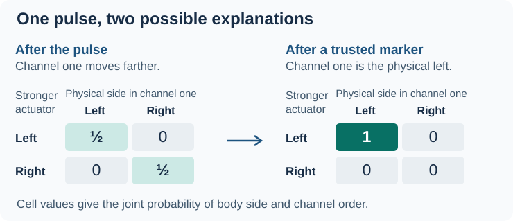
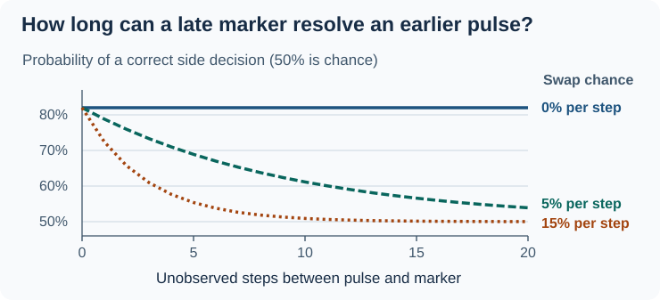

# Which side is weaker when a tracker swaps the leg labels?

A robot can walk with one weak actuator while its camera intermittently exchanges the names of the two legs. A smooth pair of trajectories can fit the video under either interpretation. The distinction matters when a controller must choose which actuator to assist. **Does sharing a dynamics model between mirror-image bodies improve forecasts of the weaker actuator when side labels are unreliable?** Compare filters that both retain the possible assignments under limited training data and sparse side markers. A separate comparison measures the cost of committing early.

## What a corrected trajectory can tell us

SwapPF estimates leg opening angles from video, predicts their evolution from recent gait extrema, and chooses the better of two assignments at each step. On outdoor walking videos, person-identification accuracy rose from 85.87% with raw pose estimates to 87.76% with SwapPF (Table 1). The study also used gait symmetry as a proxy for trajectory quality because precise joint annotations were hard to obtain. A symmetry score can improve even if the inferred response of its weaker leg becomes less accurate. Whether this happens is testable on a system with known gains. [Aoyagi et al., ICPRAM 2026, §§3–4](https://www.scitepress.org/Papers/2026/144493/144493.pdf)

Chirality Nets implement physical mirroring by reflecting coordinates and exchanging anatomical labels. PI-RNN associates unordered detections with persistent tracks, demonstrated on moving sound sources. SWAP builds reflection directly into recurrent robot dynamics. Work on switching dynamical systems proves identification up to specified transformations under restrictions on the transitions and observation map. Naming a recovered track or regime “left” requires a physical reference such as a marker attached to a known actuator. [Yeh et al., NeurIPS 2019](https://proceedings.neurips.cc/paper/2019/hash/1f88c7c5d7d94ae08bd752aa3d82108b-Abstract.html) · [Díaz-Guerra et al., Forum Acusticum 2023](https://arxiv.org/abs/2306.08510) · [Lan et al., 2026 preprint](https://arxiv.org/abs/2606.19928) · [Balsells-Rodas et al., ICML 2024, Thms. 3.2 and 3.5](https://proceedings.mlr.press/v235/balsells-rodas24a.html)

## An exact test of what the observations reveal

Consider a bilateral actuator with equally likely stronger sides. Let $B=+1$ mean the left is stronger and $B=-1$ mean the right is stronger. Let $R_t=+1$ mean the detector puts the left actuator first and $R_t=-1$ mean it puts the right first. A common pulse at time zero excites both actuators. The detector reports which channel moves farther, so the observed sign is $U=BR_0$ in the noiseless case. Even after observing $U$, each side and each naming state still has marginal probability one half if the two signs were initially independent and fair. The joint belief now records which interpretations of the body and detector can both be true.

*Figure 1. A pulse produces a larger response in channel one. A simultaneous, trusted marker then identifies that channel as the physical left. Keeping only the two marginal probabilities after the pulse would discard their association.*

Allow the reported pulse sign $U$ to be wrong with probability $\eta$. During $d$ intervening steps the detector switches with independent probability $h$ per step. A side marker reports a sign $V$ equal to $R_d$ with probability $1-\epsilon$. When $\eta$, $\epsilon$ and $h$ are below one half, all errors are independent and the gap is uninformative, the best side guess is $UV$. Its accuracy is

$$
k_d=(1-2\eta)(1-2\epsilon)(1-2h)^d,\qquad
p_{\mathrm{correct}}(d)=\tfrac12(1+k_d).
$$

An even number of sign reversals gives the correct decision, and independence makes their expected product $k_d$. Now let a standardized query pulse produce true left-minus-right displacement $D=AB$ with known amplitude $A>0$. The best prediction is $Ak_dUV$ and its expected squared error is $A^2(1-k_d^2)$, the conditional variance of $D$. A filter that stores only the two separate marginal probabilities before the marker loses their association. Its best prediction is zero and its excess error is $A^2k_d^2$. A registered side-specific command or a visible anatomical feature would add information and change this bound.

*Figure 2. Calculated Bayes accuracy, with 10% error for both pulse and marker. The curves follow directly from the binary observation model.*

## A filter that can use a late marker

Maintain the joint distribution of physical state $x_t$, persistent gain difference $b$ and current naming state $R_t$, given the history available at time $t$. Here $B$ is the sign of $b$ when $b$ is nonzero. The dynamics predict $x_t$ from the preceding state, the registered action and $b$. The naming process permutes the predicted channel pair in the observation likelihood. Reflecting the entire physical experiment exchanges actuators, transforms the commands and reverses $b$. Relabeling detector channels leaves the commands and $b$ in place. If the coordinate convention changes midstream, its naming transition probabilities and marker values must be transformed with it.

On a finite phase grid, sum both naming assignments and the possible gain values exactly. In continuous state, sample physical trajectories and gain hypotheses while retaining both naming probabilities for each sample. Sum the two-state transition and observation likelihoods before resampling. Resampling the physical particles can eliminate every gain hypothesis on one side before a marker arrives. Maintain separately weighted particle pools for the two gain signs, with a distinct zero-gain state when relevant. Give each continuous competitor the same allocation. Normalize weights within each pool and update its total probability by its predictive likelihood. Record the mass and effective sample size for each sign. **The learning hypothesis** concerns tying the dynamics of these pools by physical reflection. Both models already marginalize naming states by standard Rao-Blackwellized particle filtering. On the enumerated model, known dynamics give both the same optimum. [Doucet et al., UAI 2000, §4](https://arxiv.org/abs/1301.3853)

## The experiment and what would count

1. **Check the ceiling.** Generate independent pulse and marker trials from the binary model. Verify the exact filter against the expression above, including the fair-marker limit, no switches and long delays. Add phase by discretizing a noisy periodic oscillator with known transition probabilities and two actuators with unequal gains. Vary gain, excitation, delay and occlusion independently. Hold out complete bodies and their reflected copies together. Challenge each assumption separately. Concentrate swaps where the legs cross, change the gain mid-episode, or install a unilateral spring that remains on the same side when the body is mirrored. The last condition deliberately violates the dynamics symmetry assumed by the tied model. Gait phase itself moves under reflection for an alternating gait. [Su et al., IROS 2024, §IV](https://arxiv.org/abs/2403.17320)
2. **Test which ingredient matters.** Cross tied versus untied dynamics with retaining both naming assignments versus committing to the most likely assignment. The main competitor is an untied switching recurrent state-space model with the same episode gain hypothesis, exact two-state sum and particle budget. Train both on the same pose detections, registered commands and marker stream using the same observation and marker likelihood. Use mirrored examples in the mirror-symmetric condition. Reserve hidden gains and true assignments for scoring. Report forecast error versus training bodies, effective parameters, state-likelihood evaluations and elapsed inference time. A separate oracle gets the true assignment to measure the cost of corrupted names. A SwapPF-style angle tracker followed by the same forecast head tests the cost of committing early in its gait domain.
3. **Score a physical response.** Immediately after the marker, forecast the body-frame left-minus-right displacement change produced by a prespecified bilateral pulse at a matched phase. Use the simulator's independent body-frame measurement only to score the forecast. The primary endpoint is squared error against the measured response, averaged over held-out bodies. Score both forecasts on the same independent query outcomes. Their paired difference in expected loss cancels irreducible outcome noise. Compare absolute toy risk with the analytic floor. Also report the mean squared error of the predicted stronger-side probability against its binary outcome (Brier score), naming errors and error by marker delay. Compare predicted side probabilities with observed frequencies within each swap-rate condition. Score magnitude separately near zero gain. Hold out pulse amplitudes, camera conventions and swap-burst lengths, and evaluate every method using only observations available at forecast time.

The primary oscillator comparison will use 256 training bodies, four independently reset histories per body, a marker eight steps after calibration and a 5% per-step swap probability. Use 10% marker error and reserve at least 128 independent test bodies. Form a paired interval by resampling independent test bodies and paired training seeds, keeping repeated queries within body. Use five seeds per model. Size the final test set from pilot variance before unsealing it. Use a reference displacement $A$ measured on calibration bodies. The proposed gate requires the lower end of a 95% paired interval for untied minus tied risk to exceed $0.01A^2$, at matched state-likelihood evaluations. Report elapsed time alongside that proposed tolerance.

Run the exact checks on CPUs. If the gate passes, profile the tied model and branching baseline on simulated walker joint angles with a shared eight-H100-hour pilot at Stanford HAIC, then size the matched five-seed sweep from measured throughput. A benefit only over early commitment supports retaining alternatives. A benefit limited to globally mirrored equipment identifies where sharing can help. If every method reaches the raw-history limit, better side measurements are the remaining resource in that setting.

[Portfolio](00_master.md) · [Literature and source notes](06_sources.md)
