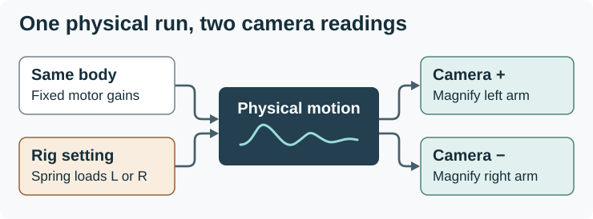
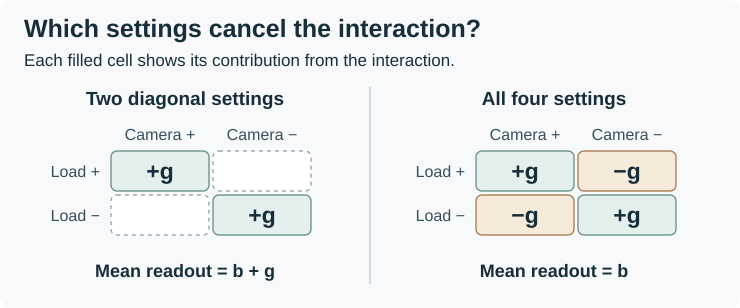

# Which part of a measured imbalance belongs to the body?

**Research question.** Which changes to the equipment and camera let us recover how an unchanged body would respond on a balanced rig?

A two-arm robot receives the same pulse on both motors. Its left arm appears to travel farther. A weak right motor, a spring loading the right arm, and a camera that magnifies the left arm can produce the same measurement. Replacing a motor would leave the camera error intact. Define the **body response** as left minus right displacement at a fixed time after a specified pulse, starting at a registered rest state, with the spring bias removed and the camera calibrated. This quantity has physical units and can be measured on separate test trials.

*Figure 1. Reversing the load requires a new run. Reversing magnification can use a second rendering of the recorded trajectory. Both views share the motion and its process noise.*

## What can be recovered by reversing the equipment?

A signed motion difference reverses under a global physical reflection. A feature with this property is called *odd*. Equivariance constrains how an odd feature changes under reflection, but any mixture of body, equipment and camera effects with that behavior also qualifies. Relaxed group convolutions already reveal physically meaningful patterns of symmetry breaking, and RECM learns how much symmetry to impose at each layer. Our criterion for attribution is whether the predicted neutral body response survives a change of equipment. [Wang et al., ICML 2024](https://proceedings.mlr.press/v235/wang24y.html) · [Pertigkiozoglou et al., ICML 2026](https://proceedings.mlr.press/v306/pertigkiozoglou26a.html)

CITRIS identifies the components of temporal factors affected by observed intervention targets. Li and colleagues show that paired interventions can identify some untouched groups under assumptions about mixing and causal structure. Nonlinear interventional state-space models establish latent-coordinate guarantees under sufficiently separating hard interventions. CoDA already adapts a dynamics model to new environments from short trajectories. Our target is the physical response shared by all models consistent with the available runs, even when individual nuisance effects remain ambiguous. [Lippe et al., ICML 2022](https://proceedings.mlr.press/v162/lippe22a.html) · [Li et al., AISTATS 2025](https://proceedings.mlr.press/v258/li25g.html) · [Tolle et al., arXiv v1](https://arxiv.org/abs/2611.08113v1) · [Kirchmeyer et al., ICML 2022](https://proceedings.mlr.press/v162/kirchmeyer22a.html)

**A physical example.** Let $s=+1$ load the left arm and $s=-1$ load the right. Let $v=+1$ magnify the left measured displacement by a factor $1+\delta$ and the right by $1-\delta$, with the factors exchanged for $v=-1$. The instrument reports only the signed displacement difference and setting labels. For true displacements $d_L,d_R$, its readout is $d_L-d_R+v\delta(d_L+d_R)$. Magnification therefore affects a *change* in position. Assume the expected true difference is $b+s a$ and the expected total travel is $k+s j$, with these laws extending to zero load. Then the mean readout is

$$
m(s,v)=b+s a+v c+s v g,\qquad c=\delta k,\quad g=\delta j.
$$

Here $b=m(0,0)$ is the body response. The interaction $g$ arises when loading opposite arms changes total travel. Reversing the rig on one body changes $s$. A global mirror exchanges both arm names and both setting signs, reverses $b$ and $g$, and preserves $a$ and $c$. The distinction gives a direct check on simulated mirror pairs.

**An exact boundary.** The diagonal mean $d=[m(+1,+1)+m(-1,-1)]/2$ equals $b+g$. If $g=0$, those two settings determine $b$ while leaving $a$ and $c$ inseparable. In the reduced model with unrestricted nuisance coefficients except for $|g|\leq G$, the sharp population interval for $b$ is $[d-G,d+G]$. Every value inside produces the observed diagonal means for suitable nuisance effects. With unrestricted interaction, all four cells determine $b$ by averaging. Computing both missing camera views on the two existing opposite-load runs completes the four settings. It adds no independent mechanical repeats. Instrument reversal has long been used to separate measurement errors. [Flack and Hannaford, *Fundamental Good Practice in Dimensional Metrology*, pp. 87–90](https://www.npl.co.uk/special-pages/gpg80_metrology#page=103)

*Figure 2. The labels inside the cells show just the interaction term. The bottom row gives the mean of the full measured responses under the stated model.*

## From a known contrast to a research contribution

For a linear response family, write $D\theta$ for the available means and $q^\top\theta$ for the neutral response at one horizon. The target is identifiable exactly when $q$ belongs to the row space of $D$. Otherwise, two parameter vectors can differ in a direction invisible to the measurements while giving different neutral answers. Classical *c-optimal design* already chooses measurements to minimize variance for a specified target, including correlated observations. Compare that allocation with one minimizing run and rendering cost subject to a limit on sampling error plus worst-case bias across calibration-compatible coefficients. Apply each allocation to both the physical fit and the neural predictors, so a better choice of trials can be distinguished from a better predictor. The scientific opportunity is to determine when a model learned across bodies can reduce the number of runs required for a useful prediction under those costs. [Holland-Letz, Dette and Pepelyshev, JRSS B 2011](https://pmc.ncbi.nlm.nih.gov/articles/PMC3106301/)

An additional effect proportional to $s^2$ is constant at all four corners and vanishes at neutral load. It can shift the estimated body response even with unlimited repetitions. On separate calibration bodies, measure neutral truth and vary load magnitude to test the bilinear assumption. A bound fitted on those bodies is a sensitivity assumption for new bodies. Arbitrary responses outside the measured settings can disagree at neutral. [Saengkyongam et al., ICLR 2024](https://proceedings.iclr.cc/paper_files/paper/2024/hash/aa9508b2577e0d9c824da9e2e27fe9d6-Abstract-Conference.html)

1. **Test the boundary on two damped actuators.** Independently vary gain, spring loading, camera magnification and pulse shape. Randomize run order, reset the actuators and keep the logged controller open loop. Compare one setting, the diagonal and the four corners with known process and measurement noise. Check estimated response sets against the algebra. Then introduce unequal reversal magnitudes, a quadratic load effect, and a training design assigning disjoint sets of bodies to different rigs. A naive contrast that misses neutral truth on calibration bodies fails the physical attribution test.

2. **Test the learning hypothesis.** Infer a distribution over a persistent body code from support trials. In a recurrent state-space model, physical state, command, body code and load determine the transition. Camera settings enter the observation model. Train on support/query episodes by predicting query trajectories, tying parameters under global physical reflection. Compare a contextual recurrent model, CoDA-style adaptation, CITRIS with a residual body code, calibrated system identification and mirror augmentation. Match support, metadata, views, capacity and tuning. Remove reflection tying and mechanism-specific inputs separately. A body-ID lookup on familiar bodies tests memorization. On new bodies, freeze the inferred code before query outcomes arrive.

3. **Score the consequence in physical units.** Start the CPU pilot with 32 training bodies, 16 separate calibration bodies and 32 held-out bodies, four pulses, and four physical repetitions per load direction and pulse. All views of each run stay together. Only the evaluator sees neutral trials on test bodies. Compare absolute neutral-response error across methods at equal numbers of independent runs. Use a paired interval over test bodies and independent training seeds, retaining both views together in any resampled run. Report interval coverage and width, worst-context error and loss from choosing the wrong actuator correction. Hold out pulse shapes and reverse the training association between magnification and the weak side.

Set the accuracy target from the smallest displacement difference that changes the correction choice in the simulator. Fix that tolerance and size the confirmatory cohort on separate pilot data. Profile a compact trajectory model and the strongest contextual baseline on one Stanford HAIC H100 within a combined 24 GPU-hour pilot cap. Budget five matched seeds from measured throughput. Advance to a rendered bilateral walker only if the structured model reaches the tolerance with fewer runs than the contextual model and the calibrated design baseline. If a changed allocation improves both predictors and their paired difference lies within the decision tolerance, the result supports the design change alone. Inaccurate neutral predictions after a full crossing call the assumed response law into question. A physical interpretation of individual neural coordinates would require a separate identification result.

[Collection overview](00_master.md) · [Primary-source analyses](06_sources.md)
