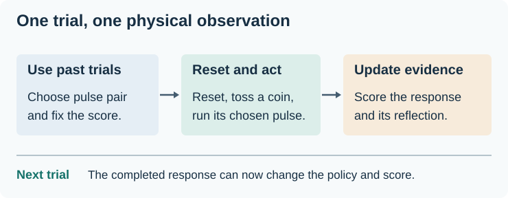
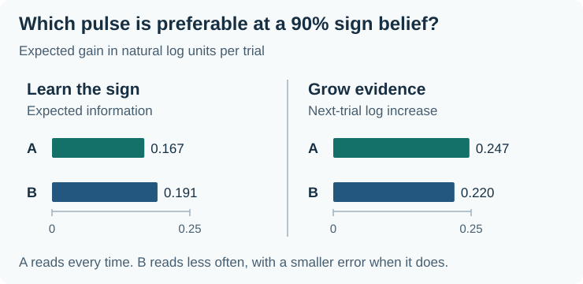

# Which experiments detect broken reflection symmetry by a deadline?

A robot can apply a gentle pulse that always yields a reading or a sharper one that depends on foot contact. The pulse that best reveals which side is stronger may be a poor choice for detecting a departure from symmetry. **Can a learned dynamics model increase the chance of detecting broken reflection symmetry within a fixed physical budget when its predictions are imperfect?** A biased sensor can also produce unequal responses to mirrored commands. Equipment and camera reversals help attribute the difference to the body. [Proposal 3](03_separate_body_and_apparatus.md)

## An experiment with a checkable null

Hold the physical body, including its gain sign, fixed for an entire sequence. In each trial, reset its moving state and controller memory. From past trials choose an allowed pulse and its mirror, called a *probe orbit*. Flip a fresh fair coin to choose which to apply. Record the orientation and the measured trajectory together as $X_t$. The reflection $M$ exchanges the two commands and transforms their responses into the opposite physical frame. The null says that, conditional on the entire past and the selected orbit, $X_t$ and $MX_t$ have the same distribution. Symmetric reset noise, matched actuation, a reflection-respecting controller and calibrated readout are ways to justify this assumption in a simulator. For alternating gait, reset phase from a reflection-invariant distribution or mirror the reset phase together with the command. Starting every trial on the left foot can break the null. Resampling a fresh gain sign on each trial can instead conceal a persistent defect.

*Figure 1. The model chooses the experiment and score before the coin toss. Reflecting the measured response evaluates the score a second way on the same trial.*

Let $T_t$ be any positive, oriented score fixed before the coin and response. Give more weight to trajectories expected under one signed alternative. Starting with $E_0=1$, update

$$
e_t=\frac{2T_t(X_t)}{T_t(X_t)+T_t(MX_t)},\qquad E_t=E_{t-1}e_t.
$$

The factors at $X_t$ and $MX_t$ sum to two. Under the null, their symmetry gives each increment conditional mean one. The product is therefore a nonnegative martingale, an account whose expected balance under the null stays at its current value after the next trial. Its probability of ever reaching $1/\alpha$ is at most $\alpha$. For unknown direction, start a separate account at one half for each of two mirror-image scores. Multiply each account by its own factors and **sum the two balances**. The sum starts at one and retains the same error guarantee. An invariant score gives a factor of one. Koning derives orbit normalization and already learns an alternative from past batches. Safe Testing develops growth-optimal evidence and optional continuation. The proposed contribution concerns the choice of physical experiment. [Koning, §§3–7](https://doi.org/10.1214/26-AOS2627) · [Grünwald, de Heide and Koolen, JRSS B](https://arxiv.org/abs/1906.07801)

## When two reasonable objectives choose different pulses

Consider a persistent sign $S$ identifying the stronger actuator. A pulse gives a signed body-frame reading with probability $r$, independently of sign, and an inconclusive reading otherwise. Conditional on a reading, its sign is wrong with probability $q$. Reflection reverses a signed reading and preserves the inconclusive result. The command coin is independent in this toy. Both pulses have the same cost. Pulse A has $(r,q)=(1,0.08)$ and pulse B has $(0.6,0.001)$.

For the calibrated model, let $w$ be the current probability that $S$ is positive and $p=q+w(1-2q)$ the probability of a positive sign given a reading. Write $h(p)=-p\log p-(1-p)\log(1-p)$ for binary entropy in natural units. The **expected reduction in sign uncertainty** is $I=r[h(p)-h(q)]$. For the two-sided evidence account above, the branch capitals divided by their sum give the sign posterior under these exact likelihoods and a balanced initial prior. Its **expected next log increase** is $G=r[\log 2-h(p)]$. A blank reading updates neither quantity.

*Figure 2. Values are calculated from the specified channels at the same history and cost. They describe the next trial. No learned policy or robot was evaluated.*

At $w=0.9$, B gives more sign information (0.191 versus 0.167 nats), while A has higher expected log growth (0.247 versus 0.220). At a balanced start the two-sided account is unchanged after one reading. If the alternative sign is specified, its oracle log growth is $r[\log 2-h(q)]$, exactly the information about a balanced sign. More generally, $I+G$ equals that quantity in this toy. These one-step rankings leave the choice of an entire sequence open.

## A deadline changes the answer

Give each trial unit cost, cap the sequence at twelve and reject when the account reaches 20. Under the alternative the two persistent body signs are equally likely. A signed reading multiplies each branch by $2(1-q)$ for a match or $2q$ for a mismatch. A blank multiplies both branches by one. For the null-membership comparator, assign prior mass one half to a symmetric body and one quarter to each signed body. A symmetric body produces a fair sign and has the same missing-reading rate for each pulse.

| Acquisition rule | Probability of detection by trial 12 | Mean trials charged, capped at 12 |
|---|---:|---:|
| Always A | 0.801 | 8.97 |
| Always B | 0.837 | 9.62 |
| Greedy log growth of two-sided evidence | 0.801 | 8.97 |
| Greedy information about sign | 0.848 | 9.33 |
| Greedy information about null membership | 0.836 | 9.07 |
| Optimal for detection by the deadline | 0.951 | 9.62 |

To reproduce the table, initialize both capitals at one half. At each state, branch on positive, negative and blank readings with probabilities $rp$, $r(1-p)$ and $1-r$ under the current sign belief. Absorb paths at the threshold or deadline. For the oracle, work backward, choosing the pulse with the higher probability of a threshold crossing before time runs out. Break ties by lower expected capped cost. The greedy rules favor A on ties. The membership update compares the two-sided likelihood ratio to the specified symmetric model, so its null posterior is $1/(1+E_t)$.

Greedy evidence growth always chooses A on its reachable histories. The deadline-optimal rule detects more often and spends more trials on average. **The learning hypothesis** is that predicting how a sequence of pulses affects the remaining chance of detection can improve deadline power under varying contact conditions. One-step evidence growth is the ablation. A poor predictor could lose to a fixed pulse.

## An experiment that would test the learning claim

Deep Adaptive Design already trains policies to learn parameters over multiple trials. Controlled sensing already treats sequential discrimination, including action costs and Markov observations. Hsu and Shekhar already adaptively bet across data sources and bound the stopping time. Their selected source yields two independent observations. Here a trial yields one randomized orientation. The proposed gain comes from sharing knowledge of pulse shape and contact dynamics across related experiments. [Foster et al., ICML 2021](https://proceedings.mlr.press/v139/foster21a.html) · [Nitinawarat et al., IEEE TAC](https://arxiv.org/abs/1205.0858) · [Nitinawarat and Veeravalli, Sequential Analysis](https://arxiv.org/abs/1310.1844) · [Hsu and Shekhar, ISIT 2026](https://arxiv.org/abs/2512.22403)

1. **Learn the response to a probe.** Use a resettable bilateral oscillator with an intermittent contact sensor. Randomize coverage of pulse amplitudes and durations on training bodies, vary contact stiffness independently of gain, and hold out intermediate waveforms and new bodies. Only reflection-invariant information about the next reset, such as total preload, is available before selection. Fit a recurrent model to the response trajectory and missing-reading probability. On a finite pulse menu, use simulated continuations to estimate the chance of crossing by the cost cap for each first pulse and remaining budget. Fit a policy to the best estimated choice and repeat with the updated continuation policy. Condition on past data and both capitals. A fitted, oriented response likelihood supplies the numerator in the evidence factor. Training simulations supply the sign and null labels used to fit oriented likelihoods and information objectives. Give all fitted methods the same labels during training. At evaluation, freeze a common scorer and withhold those labels from every policy.
2. **Give the comparators the same opportunity.** Compare deadline planning with a policy trained for cumulative information about whether the null holds over the same horizon, a fitted controlled-sensing policy, greedy growth, a validation-selected fixed pulse and the oracle in the toy. Match data, cap, lookahead, simulated candidates and tuning resources for learned planners. Include a model-free rule that estimates each pulse's evidence yield from past trials with exploration. In a separate paired-trial arm, run both orientations on independently reset states, map the opposite response back through the physical reflection, charge both costs, and compare the published multi-source betting rule with a dynamics-informed selector on those same pairs. An oracle-scorer ablation isolates error in the bets.
3. **Report the full stopping outcome.** Fix the primary budget before inspecting test outcomes. Compare detection probability at that budget and report curves over cost together with mean capped cost, charging the cap to non-detections. At $\alpha=0.05$, use 10,000 independent null sequences per declared toy condition and report a binomial interval for ever crossing. This checks implementation. The finite-sample guarantee comes from the conditional null. Under alternatives, pair policies by test body, repeat learned fits across five seeds, and report intervals for paired differences. Reverse the training association between friction and gain, vary missingness, and include weak alternatives. A biased sensor or asymmetric reset changes the scientific null. Record those rejections separately from false alarms under calibrated conditions.

Use CPUs for the finite experiment. Profile the recurrent model and the strongest learned comparator within a proposed shared eight-H100-hour pilot at Stanford HAIC before scheduling a larger contact simulator. Count simulator transitions and policy latency as well as GPU-hours. For a proposed decision margin, require the lower bound of a paired 95% interval to exceed five percentage points against the strongest challenger selected on validation bodies at matched physical cost. Freeze this margin and the cost cap before sizing the independent test cohort from pilot variance. If gains disappear under equal lookahead, the result concerns planning horizon. If no defensible symmetric reset exists, this validity argument does not cover that application.

**How much model error can the deadline tolerate?** Give both models the same initial history distribution, including preload, and the same prior over alternatives. Suppose at most $H$ trials fit within the cap. For every reachable history and pulse, assume the conditional observation laws under the true and learned models differ by at most $\epsilon$ in total variation, the largest difference in probability they assign to an event. Include new reset information, missing readings and random costs in the observation. Fix the scoring and stopping rules. Two coupled runs using the same policy can then agree through all $H$ trials with probability at least $(1-\epsilon)^H$. Their crossing probabilities differ by at most $d_H=1-(1-\epsilon)^H$. A planner within $\eta$ of optimal power in the learned model consequently loses at most $2d_H+\eta$ against an oracle planning with the true laws and the same scorer. Both policies use observable history and the same action and cost constraints. Each policy accounts for one $d_H$ term. This elementary bound gives a stress test. Estimate exact errors in the toy, then ask whether an error bound weighted by the pulses the planner actually uses can predict failure more sharply. Without positive evidence growth away from the null, the same argument cannot bound an unlimited waiting time. Non-rejection by the deadline can reflect weak or poorly chosen pulses.

[Portfolio](00_master.md) · [Source notes](06_sources.md) · [Adversarial review](05_adversarial_review.md)
