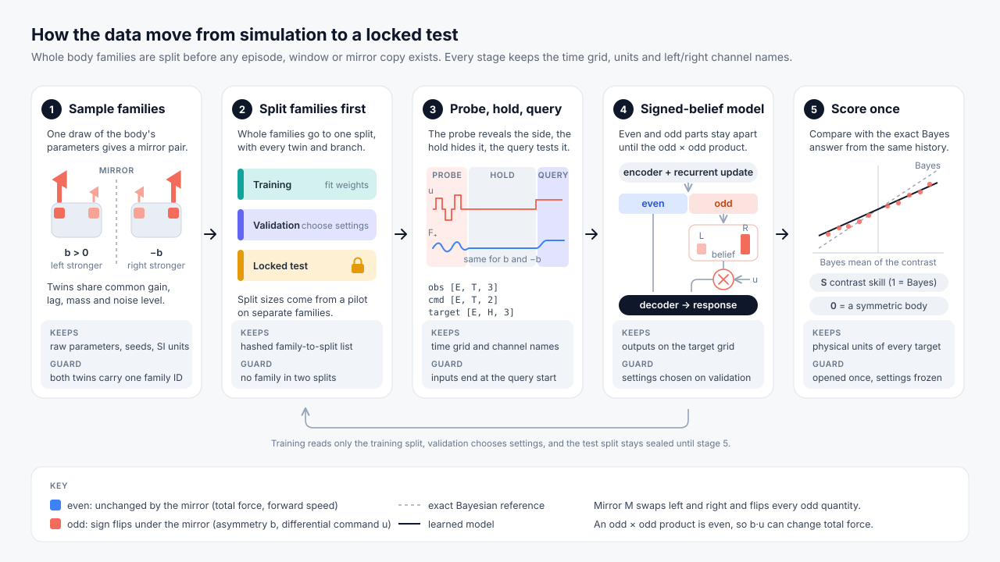

# Testing Whether World Models Keep a Hidden Asymmetry: A Leakage-Proof Pipeline and a Preregistered Analysis

**Version 5 · Research proposal · 23 October 2026**
**Status:** plan only; no models have been trained. Revised after [Review 4](../../../output/research-claude/review-v04.md) and its Codex adversarial review. Version 4 fixed what each experiment measures. This version fixes how the data flow and how the results will be judged. Every array has a declared shape and parity. Every pipeline step names what it preserves, what keeps test information out of training, and which unit is independent. The analysis plan is frozen before the first model is trained. It also strengthens the baselines that could explain the remedy away (input-conditioned SymPE, autoregressive mixtures, a flag-free snapshot) and corrects the control task and the decision rules. The mechanism section is rewritten for reading, with the history of corrections moved to the change log.

## Abstract

World models learn to predict how a system responds to actions, and robot learning increasingly builds left–right symmetry into them. A symmetric body plan does not guarantee a symmetric body. A stronger side often stays hidden until an input pushes the two sides differently, and a model that must predict the response to such an input has to infer the asymmetry from brief evidence, keep it through uninformative stretches, and combine it with the new command. We describe four ways this can fail, each with a formal statement and a measurable signature, and we propose probe–delay–query episodes that switch each failure on and off while the information in the data stays fixed. A signed-belief world model addresses each failure with one removable component and is compared with reconstruction-based and latent-prediction world models, existing ways of breaking symmetry, and baselines that store their state when the evidence ends. Retention is scored against exact Bayesian references. Because conclusions about memory are easy to fake through leakage between training and test data, the proposal specifies a data contract in which whole body families are split before anything is derived from them, every transformation preserves the arrays' shapes and reflection rules, and the analysis is registered before any model is trained.

## 1. Introduction

A world model is a learned simulator. Given the history of observations and a planned sequence of actions, it predicts what will happen, so a controller can test an action before committing to it. For legged robots, exoskeleton users and prosthesis wearers, the answer to "what happens if I push harder on the left?" depends on how strong each side is, which ordinary motion can hide.

Symmetry is one of the most effective tools in robot learning. Morphological symmetries constrain a robot's dynamics and can be built into learned models (Ordoñez-Apraez et al., 2025), and equivariant world models such as SWAP (Lan et al., 2026) use left–right symmetry to learn faster and generalize to mirrored terrain. These priors describe the body *plan*. A particular body can break the symmetry through a weak motor, a payload, a brace or a stroke, and the question is whether a model built around symmetry can still represent, keep and use that difference.

The user's earlier work gives a reason to ask. In a study of JEPA-inspired pose restoration, a baseline that always predicted zero change in knee asymmetry had lower asymmetry-change error than all sixteen trained variants, which nonetheless restored noisy poses well. A second study found that every test video also appeared in training, which made its classification results uninterpretable as generalization. The first result motivates the question; the second explains why this proposal spends so much effort on the data contract. A study of memory is especially exposed to leakage, because any route by which test information reaches training looks exactly like a model that remembers.

**Contributions.** (1) A diagnostic account of four mechanisms by which a predictive model can lose a signed asymmetry. (2) Probe–delay–query episodes, which give each mechanism its own knob while the evidence stays fixed, scored by contrast skill against exact Bayesian references. (3) A signed-belief world model with one removable component per mechanism. (4) A matched comparison with the strongest alternatives. (5) A data contract and a preregistered analysis plan that make the conclusions checkable.

## 2. Setting

### 2.1 The two-motor cart

A cart is pushed by a left motor with gain $g+b$ and a right motor with gain $g-b$, with $g > |b|$, so $b$ is positive when the left motor is stronger. A common command $a$ drives both motors and a differential command $u$ raises the left command and lowers the right. Each activation follows its command through a lag, $\tau\dot q_L = a+u-q_L$ and $\tau\dot q_R = a-u-q_R$. Once the canonical state is reached, the activation sum stays at $2a$, and writing $d(t) = q_L - q_R$,

$$F_+ = F_L + F_R = 2ga + b\,d(t).$$

The cart obeys $m\ddot x = F_+ - kx - c\dot x$. Sensors report position, velocity and total force with Gaussian noise; the individual motor forces are never observed. With $u = 0$, $d$ decays to zero, and total force is $2ga$ for either sign of $b$. A differential probe makes $d(t)$ nonzero and reveals the sign through $b\,d(t)$.

### 2.2 Reflection and parity

A mirror reflection $M$ swaps left and right. **Even** quantities are unchanged by it (total force, position, velocity, $a$, $g$); **odd** quantities change sign ($b$, $u$, $d$). The product of two odd quantities is even, which is how $b\,d$ enters the total force. A function is **equivariant** if $f(Mx) = Mf(x)$. Reflecting an episode leaves every observation unchanged, negates every differential command, and exchanges the query $+u^*$ with $-u^*$, so a target indexed by its query moves with it.

**Assumption S.** The distribution of $(g, |b|)$ does not depend on the sign of $b$, which is $\pm$ with probability one half; each probe's overall sign is drawn independently of $b$ with probability one half; the initial state, hold and query set are unchanged by reflection; and sensor noise has the same law after reflection. Under S, the best squared-error predictor is equivariant (Proposition 0).

### 2.3 Episodes, target and point prediction

Each episode has a **probe** (from the canonical rest state, a balanced pattern of alternating differential pulses with random overall sign, so that $\sum_t d(t) = 0$), a **hold** (a fixture returns the cart to the canonical position and holds it with $u = 0$ for $D$ seconds while the model's memory is kept; after a one-second washout the hold observations no longer depend on $b$), and a **query** (release, then a constant differential command $u^*$ for $H = 0.5$ s, predicted open-loop from the memory at the query origin).

The query impulse is $J(u^*) = 2gaH + 2bu^*\kappa$ with $\kappa = H - \tau(1 - e^{-H/\tau})$, and the **query contrast** is $r = \tfrac12[J(+u^*) - J(-u^*)] = 2bu^*\kappa$, computed by the simulator from two branches cloned from one saved state. A model's point prediction $\hat r$ is its predictive mean contrast: a stochastic model draws $N$ bodies, uses each draw for both branches, and averages the $N$ sampled contrasts. $N$ is fixed before testing at a value for which doubling it changes validation contrast skill by less than 0.005. Individual samples feed the distributional scores.

## 3. Four ways to lose the hidden side

For each mechanism: what it says, the formal statement (proved in Appendix A), and the test.

**M1. An undecided but persistent body.** When the evidence favors neither side, the correct prediction is "one of two mirror-image bodies, the same one throughout". A deterministic point prediction cannot express this, and neither can a unimodal distribution or one whose trajectory factorization lets the body change from step to step. *Formal:* if $f$ is deterministic and equivariant and $Mx = x$, every odd component of $f(x)$ is zero, so for a passive history a deterministic equivariant point predictor gives zero contrast; an equivariant predictive distribution need only be reflection-invariant, which allows two modes of opposite contrast (Proposition 1). The requirement concerns the output family and how it factorizes over a rollout, not where the randomness lives. A deterministic latent feeding a mixture head can be bimodal. A per-step mixture whose components are drawn *independently* at each step lets the body switch, but an *autoregressive* mixture that conditions on its own generated history can pick a side at the first informative step and keep it. Only the independent factorization is guaranteed to fail. *Test:* on passive histories, compare the energy score of the predicted branch pair and of whole query trajectories across five output families with the same trajectory loss and state budget (Gaussian; mixture over the branch pair; independent per-step mixture; autoregressive per-step mixture; body drawn once per trajectory).

M1 is a claim about predictive *distributions*. Under passive histories a zero-mean prediction is Bayes-optimal, so M1 cannot by itself explain a loss of contrast skill on probed episodes. It enters the explanation of a Loop 1 failure only if replacing the failing model's output family, with everything else fixed, raises its probed contrast skill.

**M2. Competition for capacity.** Under squared error and limited capacity, a model keeps the quantities with the most predictable variance, so a small signed response can be dropped although it is perfectly predictable. *Formal:* among linear predictors of rank at most $k$, the squared-error optimum keeps the $k$ leading eigenvectors of the covariance of the best linear prediction; under S that covariance separates into even and odd blocks, and the odd target is predicted as zero once all its eigenvalues fall below the $k$-th largest even one (Proposition 2). *Test:* an exact linear experiment with an explicit statistic (the balanced-probe sum $s_o = \sum_t d(t)F_{+,t} = b\sum_t d(t)^2 + \text{noise}$, the mean hold force $s_e = 2ga + \text{noise}$, and the recent values of predictable distractor channels). Inputs and targets are centered with training means and an unrestricted intercept is fitted outside the rank budget, since a constant target (the branch sum when $g$ is known) would otherwise consume a rank. Reduced-rank regression should then drop the contrast exactly where the computed spectrum says. The nonlinear world models see rising distractor variance and are compared with the linear boundary without being claimed to match it.

**Keeping the manipulation intact.** Standardizing each condition's channels by its own variance would cancel the distractor-variance knob: a distractor scaled by $A$ and then divided by its standard deviation is unchanged. Channel scales for every capacity condition are therefore computed once, from the base condition's training families, and frozen. The post-normalization spectrum is reported for each condition. Capacity experiments use raw squared error; parity normalization is used only in the remedy experiments of Loop 3.

**Objectives under M2.** Littwin et al. (NeurIPS 2024) show that in deep linear networks, latent prediction (JEPA) learns features in an order governed by their input-to-target regression coefficients, with a cross-covariance dependence in the learning times, while reconstruction is governed by variance. For the asymmetry, the coefficient is $st\,\mathrm{Var}(b)/(s^2\mathrm{Var}(b) + \sigma^2)$, which approaches $t/s$ for informative probes. Predictable distractors also have high coefficients, so no ordering follows in general. The prediction tested is therefore narrow: with *low-coefficient* distractors, latent prediction keeps the asymmetry where reconstruction loses it. Their solved dynamics also assume a specific setting (stop-gradient targets from the current encoder, square weight matrices, aligned initialization and gradient flow), so the deep-linear study first reproduces that setting exactly and only then adds an EMA target and a bottleneck as empirical extensions (Appendix B).

**M3. An unrewarded memory.** While the hold reveals nothing about the asymmetry, losses on hold observations give no reason to keep it. *Formal:* if hold observations after washout are independent of $b$ given the rest of the history, and the model's predictions of them do not depend on the odd part $z_o$ of its state, hold losses have zero gradient with respect to $z_o$; later losses reach it through the state Jacobians across the hold, and for a linear odd update with operator norm $\|A_o\| \le r < 1$ both the stored value and that signal shrink at least as fast as $r^D$ (Proposition 3). The independence condition fails if the hold refines a nuisance parameter coupled to $b$, which is why the primary memory condition fixes $g$. *Test:* contrast skill read from the frozen state at holds of 2, 4 and 8 s, when the representation is shaped by probe and hold losses only, by added query losses, or by a weight-matched alternative. In every arm, a response readout is trained on the frozen state with gradients stopped at the memory, so decoding is equalized.

**M4. A hard-to-learn product.** The asymmetry changes total force only through its product with the differential command, so a model must form that product somewhere. *Formal:* an equivariant head that predicts an even outcome from a frozen state and is additively separable in state and odd command predicts zero contrast for every state (Proposition 4). This is a construction check; in rollout models any nonlinear transition can form the product. *Test:* at matched recoverability of $b$ from the frozen state, the number of training episodes needed to reach contrast skill 0.8 with explicit multiplicative fusion versus concatenation. The additive head serves as an implementation control.

**A shared cost.** Merging two equally likely histories whose mean responses at the same query are $m_+$ and $m_-$ costs at least $(m_+ - m_-)^2/4$ in squared error (Lemma A1).

## 4. The benchmark

### 4.1 Knobs

| Knob | Values | Mechanism |
|---|---|---|
| Probe present | passive / probed | M1 |
| Output family | Gaussian / pair mixture / per-step mixture / persistent draw | M1 |
| Predictable distractors ($n_d = 8$) | variance in 6 steps spanning the linear boundary; coefficient below, equal to, above the asymmetry's | M2 |
| White distractors | 0, 8, 32 channels | M2 |
| Even spread (half-width of $g$ range) | 0, 0.1, 0.2, 0.3 | M2 |
| Probe frequency in training | 100%, 30%, 10% | M2 |
| Width | 1, 2, 3, 5, 9 (linear); 8, 16, 64 (nonlinear) | M2 |
| Hold length | 0, 2, 4, 8 s | M3 |
| Hold flag visible | yes / no | M3 |
| Losses shaping the representation | probe+hold; +teacher-forced query; +open-loop query; weight-matched | M3 |
| Fusion | concatenation / multiplicative (additive head as control) | M4 |
| Population balance $P(b > 0)$ | 0.5, 0.7, 0.9 | secondary |

Odd distractors change sign under reflection and compete with the asymmetry in the odd block. The population-balance knob violates Assumption S on purpose, which tests what equivariance and mirror augmentation cost when left-stronger bodies are more common (Lawrence et al., ICLR 2026).

### 4.2 Exact references and the information audit

With $\tau$, $m$, $k$ and $c$ known, every cart observation is linear in $(g, b)$, and the posterior under Gaussian noise follows from a two-parameter regression evaluated on a grid refined until the posterior mean of $b$ moves by less than 1% of its prior range. A secondary condition with unknown $\tau$ and $m$ integrates $(g, b)$ exactly and samples $(\tau, m)$ by importance sampling. For the walker, with all parameters except $b$ fixed and a canonical start, the probe is simulated on a grid of $b$ to give the exact likelihood up to integrator tolerance.

The **information audit** reports, for every condition and hold, the Bayes risk of the contrast given the full history and the posterior correlation of $g$ and $b$ at the end of the probe. Skill depends on the Bayes risk as well as on the model's risk: with $R_0 = 1$ and a fixed model risk of 0.2, lowering the Bayes risk from 0.1 to 0 moves skill from 0.89 to 0.80. Every result therefore reports the model's raw risk, the Bayes risk and the excess risk alongside skill. Claims that a model *loses* information over the hold are made only in information-matched conditions ($g$ known, where the audit shows constant Bayes risk); elsewhere a change in skill is decomposed into its model and Bayes parts. Information references are the full-history posterior, a recent-window posterior from the last second of the hold (holds of two seconds or more) and a no-probe posterior.

### 4.3 The walker

The dm_control planar walker (Tassa et al., 2018) gets knee gains $1+b$ (left) and $1-b$ (right). A **harnessed probe** applies differential knee pulses with the feet off the ground; a **harnessed hold** resets the legs to a canonical hanging pose with zero commands; a **released query** applies, from a canonical standing pose, a 0.5 s open-loop sequence $a_{\text{nom}}(t) + u^* d(t)$ with a symmetric push-off $a_{\text{nom}}$. The endpoint is the contrast in total vertical ground impulse between $\pm u^*$, divided by body weight times $H$. A week-2 check confirms the released walker stays upright for 0.5 s and the contrast is monotone in $b$. A secondary **walking** condition, which reveals $b$ continuously, is reported separately.

## 5. Measurements

**Contrast skill (primary).** With $R_{\text{model}} = \mathbb E[(\hat r - r)^2]$, $R_0 = \mathbb E[r^2]$ for a model that always predicts a symmetric body, and $R_{\text{Bayes}}$ for the exact Bayes predictor at the same hold,

$$S = \frac{R_0 - R_{\text{model}}}{R_0 - R_{\text{Bayes}}},$$

estimated as a ratio of sums over test episodes. $S = 1$ is as good as the data allow, $S = 0$ no better than a symmetric body, and $S < 0$ worse than a symmetric body. The primary analysis uses probe strengths at which $R_0 - R_{\text{Bayes}} \ge 0.8\,R_0$.

**What a difference in skill means.** A model's excess squared contrast error over the Bayes predictor is $(1 - S)(R_0 - R_{\text{Bayes}})$. At the primary probe strength, a loss of 0.1 in skill therefore adds at least $0.08\,R_0$, an error whose root-mean-square is about 28% of a typical contrast.

**The dial-a-force task** turns this into control error. The response to a command $u$ changes the query impulse by $\gamma u$, where $\gamma = r/u^* = 2b\kappa$ is the contrast per unit command. A controller must choose $u \in [-u_{\max}, u_{\max}]$ to change the impulse by a target $\Delta J^*$ of random sign. The plug-in controller sets $u = \mathrm{clip}(\Delta J^*/\hat\gamma)$, and $u = 0$ when $|\hat\gamma|$ is below a small threshold. The Bayes decision under squared miss is $u = \mathrm{clip}\big(\Delta J^*\,\mathbb E[\gamma \mid H]/\mathbb E[\gamma^2 \mid H]\big)$, which is the reference. With the plug-in rule, a model that predicts the wrong sign achieves $-\Delta J^*$, missing by twice the target, while doing nothing misses by the target; a model that shrinks $\hat\gamma$ toward zero over-commands, and the clip then caps the overshoot. A relative error of about 28% in $\hat\gamma$ produces a miss of about a quarter of the target for a typical body, which is why 0.1 is the meaningful difference in skill used below. The cost is reported relative to the Bayes decision.

**Diagnostics.** Attenuation (regress $\hat r$ on the Bayes mean; 1 means predictions move one-for-one with what the data support); calibration (regress $r$ on $\hat r$ with intercept); frozen-state readouts of $b$ (linear and two-layer, shared across delays and per delay, read as usable information for each class; Xu et al., ICLR 2020); context transplants between bodies with matched commands and noise but different $b$, with sham and nuisance transplants; energy scores of the branch pair and of whole query trajectories, CRPS, Brier score of $P(b > 0)$, and coverage of 90% intervals. **Guardrail:** next-step error during probe and hold.

## 6. The signed-belief world model

**Parity-split layers.** Every hidden vector is split into an even and an odd part, $h = (h^+, h^-)$, with reflection acting as $(h^+, -h^-)$. Linear maps connect even to even and odd to odd, with biases on the even part only; odd units are multiplied by even gates, and products of two odd vectors, $(Uh^-) \odot (Vh^-)$, feed even units (the gated construction of Weiler et al., 2018). The recurrent update is a GRU built from these pieces with even gates.

**Evidence slot (M3).** A persistent slot $c = (c^+, c^-)$ accumulates evidence, $c_t = c_{t-1} + \gamma_t \odot \Delta_t$, with an even learned gate $\gamma_t \in [0, 1]$; a closed gate copies the slot unchanged, so its odd part does not decay. This matches how evidence arrives in the cart, where $\sum_t d(t)F_{+,t}$ is a running sum. The hold flag is given to every model or to none; the flag-free arm is primary.

**Two-sided belief (M1).** One small network $\psi$ is evaluated on $(c^+, +c^-)$ and on $(c^+, -c^-)$. Evaluation $s \in \{+1, -1\}$ returns a logit $\ell_s$, a log-normal distribution for a positive magnitude $\rho$ and a distribution for even context. Component $s$ has weight $\pi_s \propto e^{\ell_s}$ and odd context $\kappa^- = s\rho$. Reflection negates $c^-$, which swaps the evaluations and negates the odd context, so the mixture is equivariant. Under passive histories the weights stay at one half; after a probe, evidence in $c^-$ moves weight to one side. For a two-element group, evidence-dependent sign weights of this kind are an instance of the input-conditioned symmetry breaking of SymPE (Lawrence et al., ICLR 2025), whose inversion kernel allows weights proportional to $\exp(-E(g^{-1}x)/T)$. The belief is therefore an existing construction, and the model's distinctive parts are its combination with a non-decaying slot, a persistent draw and explicit fusion, each of which is tested by removal. Component labels are latent predictive variables, and their physical meaning must be shown by readouts and transplants.

**Rollout and fusion (M4).** At the query origin the model draws one component and magnitude per sample, holds them for the whole trajectory, and uses them for both branches. Transition and decoder receive $\kappa^- \odot (Wu)$ as an even input. Predicted observations never update the slot or belief.

**Training.** Losses are separated by time, $\mathcal L = \mathcal L_{\text{probe}} + \mathcal L_{\text{hold}} + \lambda_1\mathcal L_{\text{qstep}} + \lambda_2\mathcal L_{\text{qopen}}$: next-step Gaussian negative log-likelihood on probe and hold, teacher-forced next-step loss during the query, and the energy score of the open-loop query trajectory pair. The expectation over the two components is computed exactly, including the cross terms of the energy score, so the weights get exact gradients. Each branch pair is rewritten as its sum and contrast, and each is divided by its training standard deviation before distances are taken; equal weights on sums and differences would only rescale ordinary error, since $(e_L+e_R)^2 + (e_L-e_R)^2 = 2(e_L^2+e_R^2)$. Training backpropagates through the whole episode.

## 7. Baselines and budgets

| ID | Model | Role |
|---|---|---|
| B1 | Reconstruction world model (DreamerV3-style) | Standard practice |
| B2 | Latent-prediction world model (JEPA-style: EMA target encoder, action-conditioned predictor, VICReg; SIGReg as sensitivity) with physical readout trained frozen and jointly | Objective (M2) |
| B3 | B1 with mirror augmentation, targets moved with their queries | Augmentation |
| B4 | Deterministic-latent equivariant model (SWAP-style), full-covariance Gaussian head over the branch pair | M1, unimodal |
| B4p | B4 with an equivariant two-component mixture head over the branch pair at the query horizon | M1, bimodal at one horizon |
| B4s | B4 with an independent per-step mixture head: components drawn independently at each rollout step | M1, bimodal, factorized so the body can switch |
| B4a | B4 with an autoregressive per-step mixture head that conditions on its own generated history | M1, bimodal, can keep a side without a persistent draw |
| B4t | B4 with a component drawn once per trajectory from the deterministic latent | M1, bimodal and persistent, no evidence slot |
| B5 | Input-conditioned SymPE (Lawrence et al., ICLR 2025): evidence-dependent sign weights from the inversion kernel, one sign drawn per trajectory and shared by both branches, continuous uncertainty matched to the signed belief | Strongest existing M1 remedy |
| B5+ | B5 with the signed belief's evidence slot | Isolates the slot from the belief |
| B6 | Approximately equivariant model (Wang, Walters and Yu, ICML 2022) | Relaxed symmetry |
| B7 | Snapshot: B1 that copies its state when the observed differential command returns to zero plus the washout, read by the response head; no hold flag needed | Simplest memory fix, flag-free |
| B7f | B1 that copies its state at the hold flag; flag arm only | Snapshot with the flag |
| B8 | VariBAD-style task-embedding belief (Zintgraf et al., 2020) | Existing belief state |
| B9 | Full-history transformer | Uncompressed memory |
| R1 | Recent-window context model (RMA-style) | Information-restricted reference |
| R2 | Invariant history encoder with unreflected query | Negative control |
| R3 | Exact Bayes predictor; privileged parameter oracle | Ceilings |

**Model classes for M1.** The *unimodal* class is {B1, B3, B4}; the *bimodal* class is {B4p, B4s, B4a, B4t, B5, B5+, signed belief}. The best member of each class is chosen by validation energy score on passive validation histories, before any test data are scored.

**A note on B7.** The probe's command schedule is observed by every model, so the end of the evidence is public information even without the hold flag. A snapshot triggered by the observed commands is therefore a legitimate flag-free baseline, and the signed-belief model must beat it in the primary arm. A secondary condition randomizes the probe's length between 1.5 and 2.5 s, with every model receiving the same observable timing.

**Matched budgets.** 80 persistent values between steps (signed belief: 64 recurrent + 16 slot; the snapshot's stored copy counts toward its 80; B9's attention cache disclosed as extra memory); parameters within 10% of the signed-belief model; identical updates, episode batches and query branches; identical time-masked losses and weights except where an arm manipulates them for every model; eight tuning configurations per model on validation families; the same Monte Carlo sample count $N$ for every stochastic model.

## 8. The data contract

The study's conclusions depend on two properties of the data: that no information about a test body reaches training, and that every transformation keeps the arrays' shapes, units and reflection rules intact. This section states both as checkable rules.

*Figure 1. Whole body families are split before any episode, window or mirror copy exists. Each stage keeps the time grid, units and left/right channel names; the strip under each stage names what it preserves and its leakage guard. The test split is scored once, against the exact Bayes predictor.*

### 8.1 Arrays

| Array | Shape and type | Channels and parity | Notes |
|---|---|---|---|
| `obs` | `[N_ep, T, 3 + n_d]` float32 | $x$, $\dot x$, $F_+$ (all even), then distractors with parity labels | 100 Hz; $T = 1000$ covers a 2 s probe and holds up to 8 s |
| `cmd` | `[N_ep, T, 2]` float32 | $a$ (even), $u$ (odd) | Applied over $[t_k, t_{k+1})$ after observing $y_k$ |
| `flags` | `[N_ep, T, 2]` uint8 | probe, hold (even) | Withheld in the flag-free arm |
| `mask`, `time` | `[N_ep, T]` bool, float32 | — | Padding is masked; time is never stretched |
| `qcmd` | `[N_ep, 2, 50, 2]` float32 | branch axis $(+u^*, -u^*)$ | Known at the query origin |
| `qtarget` | `[N_ep, 2, 50, 3 + n_d]` float32 | per 10 ms interval: end position, end velocity, interval-average force, distractors | Interval averages make the impulse exact, $J = 0.01\sum F$ |
| `index` | `[N_ep, 4]` int64 | family ID, twin sign, probe sign, replicate ID | Used for splitting and resampling |
| `hidden` | separate file keyed by family ID | $g$, $b$, $\tau$, $m$, $k$, $c$, distractor seeds | Readable only by reference and scoring code |

The walker uses the same layout with `obs` of shape `[N_ep, T, 18 + n_d]` at 40 Hz (eight joint and torso positions excluding forward translation, nine velocities, total vertical ground force), `cmd` of shape `[N_ep, T, 6]` and `qtarget` of shape `[N_ep, 2, 20, 19]` (positions, velocities and the vertical force under each foot).

**The reflection operator.** For the cart, $M$ multiplies each channel by its parity label, negates $u$, and swaps the two entries of the branch axis of `qcmd` and `qtarget`. For the walker, $M$ permutes left and right joint and foot channels (the planar walker needs no sign flips) and swaps the branch axis. Reflection never changes a shape, a unit or a time stamp.

**Automated checks, run on every generated file and in continuous integration.**
1. $M(M(x)) = x$ exactly for every array.
2. Simulating a twin with reflected parameters and commands reproduces $M$ applied to the original record, within $10^{-9}$ relative error.
3. Normalization commutes with reflection: $\text{norm}(Mx) = M\,\text{norm}(x)$.
4. Every equivariant model satisfies $f(Mx) = Mf(x)$ within $10^{-5}$ on random inputs.
5. Branch cloning: replaying identical inputs from a cloned state reproduces the original trajectory exactly.
6. No two splits share a family ID, a distractor seed or a content hash; the training data loader has no path to `hidden`, and a test confirms that it raises an error if asked.

### 8.2 Step by step

| Step | What happens | What is preserved | What keeps test information out | Independent unit |
|---|---|---|---|---|
| 1. Sample | Draw $(g, \lvert b\rvert)$; form the mirror-twin pair; draw probe signs | Parameters and seeds, saved with the generator version | Families are assigned to pilot, training, validation and test before any simulation, from a seed stream separate from all others | Family |
| 2. Distractors | Generate distractor channels | Designed variance, coefficient and parity label | Seeds are family-specific and never reused | Family |
| 3. Simulate | Probe, hold and query; clone the full state at the query origin for each branch | Native time step, SI units, named channels, shapes in Section 8.1 | Branches and replicates inherit their family's split | Episode nested in family |
| 4. Window | One history per episode, ending at the query origin | No resampling or stretching; padding masked | Query targets never enter inputs; memory resets at each episode; branches never update one another | Episode nested in family |
| 5. Augment (B3 only) | Reflect an episode with the tier's operator $M$ (Section 8.1): for the cart, negate $u$ and odd distractors and swap query branches; for the walker, also exchange left and right joint, actuator and foot channels | Every shape and unit | Reflected copies stay in their source family's split; check 2 verifies each transformed record against a simulation of the reflected body | Not a new unit |
| 6. Normalize | Scale channels | Odd channels centered at zero with symmetric scales; transforms saved and invertible | Statistics from training families only, each family weighted equally | — |
| 7. Train and select | Fit models and readouts; tune | Channel order and time grid | Selection uses validation families only; the walker's walking policy is trained on separate bodies | Training seed |
| 8. Test | Score once | Same grid and units as the targets | Run only after the analysis plan is registered and all settings are frozen | Family × seed |

## 9. Hypotheses and the registered analysis plan

**Research question.** By the ICML 2027 submission deadline (expected late January 2027, 13 weeks from now), can probe–delay–query episodes determine which of four mechanisms make standard world models lose a body's signed asymmetry, by showing for each that its knob changes the mechanism's primary endpoint in the predicted direction while the available information stays fixed? And does a signed-belief world model reach a contrast skill of at least 0.9 on held-out bodies, above the best validation-selected baseline, with next-step error within 5% of that baseline's?

**Validity gate G** (outside the statistical family). Recent-window and no-probe sign accuracy equivalent to chance within ±0.02 at holds of two seconds or more; in the primary memory condition, Bayes risk constant across holds within 1%; full-history reference reaching $R_0 - R_{\text{Bayes}} \ge 0.8\,R_0$ on probed episodes. If the gate fails, the episode design is revised and nothing else is run.

| Hypothesis | Primary endpoint | Direction | Meaningful effect and why |
|---|---|---|---|
| H2 (M1) | Energy score of the branch pair on passive histories, best unimodal minus best bimodal class member | Positive | A quarter of the gap between the true passive law and a Gaussian with the same mean and covariance, computed from the simulator: the most bimodality could gain |
| H2b (M1) | Trajectory energy score on passive histories, B4s minus B4t, with B4a reported alongside | Positive | The same quarter-gap rule, computed for whole trajectories |
| H3 (M2, linear) | Width at which reduced-rank regression drops the contrast, measured minus predicted | Zero | Exact check, reported outside the family |
| H3n (M2) | Contrast skill at the highest minus lowest distractor variance, reconstruction, width 16 | Negative | 0.1 skill (Section 5) |
| H3b (M2) | That difference, latent prediction minus reconstruction, low-coefficient distractors | Positive | 0.1 skill |
| H4 (M3) | Frozen-state contrast skill at 8 s minus 2 s, probe and hold losses only, no flag, $g$ known | Negative | 0.1 skill |
| H5 (M4) | Training episodes to reach skill 0.8, concatenation minus multiplicative, at matched readout recoverability | Positive | 25% fewer episodes, a saving that changes how much data a practitioner must collect |

**Decision table.** Each hypothesis's effect $\theta$ is oriented so that the predicted direction is positive, and $[L, U]$ is its Holm-adjusted 95% interval, with meaningful effect $\delta$. The rules are applied in order, so exactly one verdict holds:

1. **Supported:** $L > 0$ and the point estimate is at least $\delta$.
2. **Detectable but small:** $L > 0$ and the point estimate is below $\delta$.
3. **Excluded:** $L \le 0$ and $U < \delta$, so any effect in the predicted direction is smaller than meaningful.
4. **Inconclusive:** otherwise.

Only a supported mechanism enters the explanation of Loop 1's failures, and M1 additionally needs the output-family swap described in Section 3.

**Estimation.** Contrast skill and the risk terms are ratios of sums over test episodes. Energy scores use the locked sample count. Each endpoint is computed per training seed and then averaged over seeds.

**Uncertainty.** Intervals use 10,000 draws of a two-way paired bootstrap. Each draw resamples test families with replacement (keeping twins, episodes, branches and replicates together) and resamples seed indices with replacement; every method uses the same resampled families and seed indices, so comparisons stay paired. Percentile intervals are primary, with bias-corrected intervals as a sensitivity check. The pilot estimates family and seed variance components for each endpoint, and seeds (5 to 10) and test families are sized jointly so that each primary interval's half-width is at most half its meaningful effect. An endpoint that cannot meet this within the compute cap is reported as underpowered.

**Multiplicity.** The cart family is H2, H2b, H3n, H3b, H4 and H5, at a family-wise level of 0.05. The walker forms a separate replication family: for each mechanism supported in the cart, the walker replicates it if the walker effect has the same sign and its one-sided 95% interval, Holm-adjusted within the walker family, excludes zero.

**Success of the signed-belief model.** The lower 95% bound of its contrast skill is at least 0.9; its difference from the validation-selected best baseline is above zero; and the upper 95% bound on its relative increase in next-step error is below 5%. Crashed fits and non-finite predictions count against their model.

**Registration and the locked test set.** At the end of week 2, after the pilot and before Loop 1, the following are registered with a timestamp on OSF: the knob grid, the hypothesis table, every estimator and threshold, the bootstrap code and its hash, the family manifest hashes and the sample count $N$. The test split is generated from its own seed stream and stored with a hash; the scoring script checks the registration hash before reading it and runs once, in week 12. Any later change is logged with its date and reason, and every affected analysis is labeled exploratory.

## 10. The line of inquiry

**Loop 0: is the information there?** Run the references and the information audit. *Decision:* if gate G fails, revise the episode before any model is trained.

**Loop 1: do standard world models keep it?** Train B1–B4 at default settings and measure contrast skill against hold length. *Decision:* if every model reaches $S \ge 0.9$, the registered knob grid maps where they stop doing so, and the paper becomes a map of where standard practice suffices; if some fail, Loop 2 asks why.

**Loop 2: which mechanism explains the loss?** Run H2–H5 and the deep-linear study. *Decision:* each mechanism receives one verdict from the decision table, and only supported mechanisms enter the explanation of Loop 1.

**Loop 3: does the matching component repair it?** Add each signed-belief component to the best baseline, then remove each from the full model. *Decision:* if B4a, B4t, B5, B5+, B7 or B8 matches the full model on contrast skill and the trajectory energy score, the contribution narrows to diagnosis, and the paper says so.

**Loop 4: does the account transfer?** Repeat the key comparisons on the walker and run the population-balance knob. *Decision:* a mechanism counts as general only if it replicates in the walker family.

## 11. Experiment inventory and compute

One cart fit takes about 15 GPU-minutes (0.2 M parameters, 1,000-step episodes, 20,000 updates); one walker fit about 2 GPU-hours. Knobs are varied one at a time around a base configuration, except where a hypothesis names a crossing.

| Loop | What is run | Fits | GPU-hours |
|---|---|---:|---:|
| 1 | B1–B4: 8 tuning configurations + 5 seeds each | 52 | 13 |
| 2, M1 | Eight unimodal and bimodal variants (B4, B4p, B4s, B4a, B4t, B5, B5+, signed belief), tuned and seeded | 104 | 26 |
| 2, M2 | 6 distractor variances × 2 distractor types × 2 objectives × 5 seeds, plus even spread, probe frequency and width | 210 | 53 |
| 2, M3 | 4 loss arms × 2 memory types × 2 flag settings × 5 seeds, plus truncation | 90 | 23 |
| 2, M4 | 2 fusion types × 5 data sizes × 5 seeds | 50 | 10 |
| 3 | Signed belief, 4 removals, 4 additions, and B6–B9 with B7f, tuned and seeded | 182 | 46 |
| 4 | 5 models on the walker, tuned and seeded; walking policy | 45 + 1 | 100 |
| Linear studies | Reduced-rank regression and deep-linear networks | — | CPU |
| **Total** | | **≈ 735** | **≈ 271** |

The cap is 300 GPU-hours. If the pilot shows that costs exceed it, optional work is cut in this order before any primary comparison changes: the walking condition, the population-balance knob, the nonlinear width sweep, probe frequency, and the secondary unknown-$\tau$ condition.

**Timeline.** Weeks 1–2: simulators, references, information audit, gate G, pilot, walker feasibility, registration. Weeks 3–4: Loop 1. Weeks 5–7: Loop 2 and the linear studies. Weeks 8–9: Loop 3. Weeks 10–11: Loop 4. Week 12: locked test. Week 13: writing.

## 12. Limitations

All results are in simulation. The propositions hold under their stated assumptions (linear predictors and squared error for M2, a conditionally uninformative hold and a contracting odd update for M3, a frozen direct head for M4, and Assumption S). Each component of the signed-belief model exists in some form; its contribution is to address each mechanism with one removable part and to be tested against the strongest version of each alternative. If a snapshot, a persistent mixture head or SymPE-style symmetry breaking matches it, that is the finding.

## Appendix A. Proofs

**Proposition 0.** Under S, $(MH, Mq, MY)$ has the law of $(H, q, Y)$, so $\mathbb E[Y \mid Mh, Mq_0] = M\,\mathbb E[Y \mid h, q_0]$.

**Proposition 1.** $f(x) = f(Mx) = Mf(x)$, so odd components vanish. For a passive history $h$, $M(h, +u^*) = (h, -u^*)$ and total force is even, so $\hat r = 0$. A stochastic model's distribution must equal its reflection when $Mx = x$; individual samples are unconstrained.

**Proposition 2.** With $y$ and $s$ centered (or an unrestricted intercept fitted outside the rank budget), the rank-$k$ optimum projects the least-squares fit onto the $k$ leading eigenvectors of $C = \Sigma_{ys}\Sigma_{ss}^{+}\Sigma_{sy}$, with $\Sigma_{ss}^{+}$ the pseudoinverse (Izenman, 1975). Under S, even–odd cross-covariances vanish because $\mathbb E[y_e s_o^\top] = \mathbb E[y_e(-s_o)^\top]$, so $C$ is block-diagonal and, for distinct eigenvalues, its eigenvectors lie within blocks.

**Proposition 3.** A hold loss independent of $z_o$ has zero gradient with respect to it. Later losses reach $z_{o,t}$ through $A_o^{T-t}$, and $\|A_o^{n}\| \le \|A_o\|^{n} \le r^{n}$. A spectral-radius bound alone does not suffice: for $A_o = \begin{pmatrix} r & 1 \\ 0 & r \end{pmatrix}$ the off-diagonal entry of $A_o^n$ is $n r^{n-1}$.

**Proposition 4.** With $a_o = 0$, equivariance makes $g_1$ even in $z_o$; then $g_2$ is even in $a_o$, and $\hat y_e(+u^*) = \hat y_e(-u^*)$.

**Lemma A1.** The midpoint minimizes $\tfrac12(m_+ - c)^2 + \tfrac12(m_- - c)^2$, with value $(m_+ - m_-)^2/4$.

**Balanced-probe statistic.** $\sum_t d(t)F_{+,t} = 2ga\sum_t d(t) + b\sum_t d(t)^2 + \sum_t d(t)\varepsilon_t$; the first term vanishes for a balanced probe, and reversing the probe's sign negates $d$ and leaves $b\sum_t d(t)^2$ unchanged.

**Two-sided belief.** With component $s$ computed from $\psi(c^+, sc^-)$, the map $c^- \mapsto -c^-$ turns evaluation $s$ into the original evaluation $-s$ and the odd context $s\rho$ into $-s\rho$, so $q(M\kappa \mid Mc) = q(\kappa \mid c)$.

**Point prediction from samples.** One draw $\tilde r$ from the exact posterior predictive has $\mathbb E[(\tilde r - r)^2] = 2R_{\text{Bayes}}$; the mean of $N$ draws has $(1 + 1/N)R_{\text{Bayes}}$.

**Skill and excess error.** $R_{\text{model}} - R_{\text{Bayes}} = (1 - S)(R_0 - R_{\text{Bayes}})$ follows directly from the definition of $S$.

## Appendix B. The deep-linear study

Inputs and targets are generated from independent latent factors with simultaneously diagonal covariances: a *common* factor (large variance, high coefficient; the analogue of $g$), a *signed* factor (small variance, coefficient $t/s$; the analogue of $b$ under an informative probe), and distractors with coefficients below, equal to and above the signed factor's, at two variances each.

**Stage 1: the theorem's own setting.** Littwin et al.'s solved dynamics use square weight matrices, targets computed by the current encoder with stopped gradients, a particular aligned initialization and gradient flow. Stage 1 reproduces exactly this, with depths 1, 2 and 4, and a step size small enough that halving it changes each factor's learning time by less than 2%, confirming the runs approximate gradient flow. For each factor the predicted learning time is computed from their expressions, which depend on variance, cross-covariance and coefficient, and compared with the step at which the factor's projection reaches half its final norm. The test is whether the computed order holds, including the cases where it does not favor the signed factor.

**Stage 2: empirical extensions.** An EMA target in place of the stop-gradient current encoder, and a width too small to hold every factor, take the system outside the theorem. Their results are reported as empirical extensions, with the final norm of each factor's projection as the measured quantity, and no derived prediction is claimed for them.

## Change log from version 4

- **Data contract** (Review 4, R1–R2): every array has a shape, type, channel order and parity; the reflection operator is defined for both tiers; six automated checks; the step table names each step's independent unit.
- **Registered analysis plan** (R3–R4): estimators, a paired two-way bootstrap with 10,000 draws, Holm multiplicity, a separate walker replication family with a stated criterion, OSF registration at week 2 and a locked test set scored once.
- **Meaningful effects** (R5) are tied to the dial-a-force task (skill) and to the largest possible gain from bimodality (energy score).
- **M1 classes and variants** (R6–R7): unimodal and bimodal classes are listed with a validation rule; B4m is split into B4p, B4s and B4t.
- **Costed inventory** (R8) with a 300 GPU-hour cap and a cut order.
- **Figure 1** is included, with its final card showing contrast skill (R9).
- **Readability** (R11): each mechanism is stated in words, formally and as a test, with review history moved here.

**From the Codex review of version 4.**
- SymPE is represented in its input-conditioned form, with persistent sampling and matched continuous uncertainty (B5), and with the evidence slot added (B5+); the signed belief's evidence-dependent weights are described as an existing construction.
- M1 distinguishes independent from autoregressive per-step mixtures (B4s, B4a); trajectory factorizations are stated; M1 is a distributional claim and explains a probed contrast-skill failure only if an output-family swap repairs it.
- Channel scales in the capacity experiments are frozen across conditions so normalization cannot cancel the variance knob; capacity uses raw loss and parity normalization is reserved for Loop 3.
- The deep-linear study first reproduces the theorem's exact setting (stop-gradient current encoder, square weights, aligned initialization, gradient flow), with EMA and bottleneck variants as empirical extensions.
- The dial-a-force controller is corrected to $u = \mathrm{clip}(\Delta J^*/\hat\gamma)$, with the Bayes decision $\mathrm{clip}(\Delta J^*\,\mathbb E[\gamma]/\mathbb E[\gamma^2])$ as reference, and its qualitative claims are rederived.
- A flag-free snapshot triggered by the observed command schedule (B7) joins the primary arm; a randomized-probe-length condition is added.
- Augmentation applies each tier's full reflection operator, including left–right exchange of walker joints, actuators and feet.
- Reduced-rank regression is centered, with an intercept outside the rank budget and a pseudoinverse.
- The claim that Bayes normalization holds information effects constant is removed; raw, Bayes and excess risks are reported, and forgetting claims are restricted to information-matched conditions.
- Verdicts follow an ordered decision table with four mutually exclusive outcomes.

## References

- Assran, M. et al. (2023). Self-supervised learning from images with a joint-embedding predictive architecture. *CVPR*. arXiv:2301.08243.
- Assran, M. et al. (2025). V-JEPA 2. arXiv:2506.09985.
- Balestriero, R. and LeCun, Y. (2025). LeJEPA. arXiv:2511.08544.
- Bardes, A., Ponce, J. and LeCun, Y. (2022). VICReg. *ICLR*.
- Gneiting, T. and Raftery, A. E. (2007). Strictly proper scoring rules, prediction, and estimation. *JASA* 102(477).
- Hafner, D. et al. (2023). Mastering diverse domains through world models. arXiv:2301.04104.
- Izenman, A. J. (1975). Reduced-rank regression for the multivariate linear model. *J. Multivariate Analysis* 5(2).
- Kaba, S.-O. and Ravanbakhsh, S. (2023). Symmetry breaking and equivariant neural networks. arXiv:2312.09016.
- Kumar, A. et al. (2021). RMA. *RSS*. arXiv:2107.04034.
- Lan, K. et al. (2026). SWAP. arXiv:2606.19928.
- Lawrence, H. et al. (2025). Improving equivariant networks with probabilistic symmetry breaking. *ICLR*. arXiv:2503.21985.
- Lawrence, H. et al. (2026). To augment or not to augment? Diagnosing distributional symmetry breaking. *ICLR*. arXiv:2510.01349.
- Littwin, E. et al. (2024). How JEPA avoids noisy features. *NeurIPS*. arXiv:2407.03475.
- Ordoñez-Apraez, D. et al. (2025). Morphological symmetries in robotics. *IJRR*. arXiv:2402.15552.
- Smidt, T. E., Geiger, M. and Miller, B. K. (2021). Finding symmetry breaking order parameters with Euclidean neural networks. *Phys. Rev. Research* 3, 012002.
- Tassa, Y. et al. (2018). DeepMind control suite. arXiv:1801.00690.
- Wang, R., Walters, R. and Yu, R. (2022). Approximately equivariant networks for imperfectly symmetric dynamics. *ICML*. arXiv:2201.11969.
- Weiler, M. et al. (2018). 3D steerable CNNs. *NeurIPS*. arXiv:1807.02547.
- Xu, Y. et al. (2020). A theory of usable information under computational constraints. *ICLR*. arXiv:2002.10689.
- Zintgraf, L. et al. (2020). VariBAD. *ICLR*. arXiv:1910.08348.
