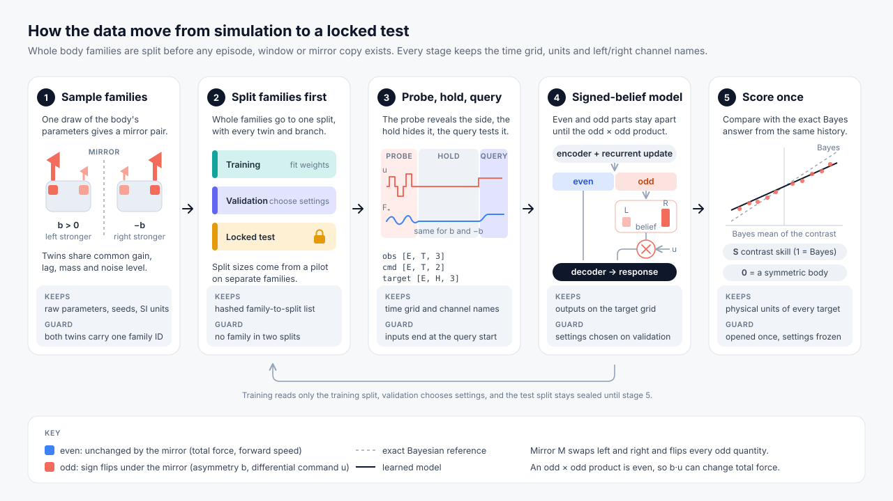

# From a Two-Motor Cart to Pixels and Real Motion: Testing Whether World Models Keep a Hidden Asymmetry

**Version 6 · Research proposal · 23 October 2026**
**Status:** plan only; no models have been trained. Revised after [Review 5](../../../output/research-claude/review-v05.md) and its Codex adversarial review. Version 5 made the study's internal logic checkable. This version asks whether its conclusions can reach beyond low-dimensional simulation. It adds a pixel tier for the walker and a re-analysis of the user's JEPA pose encoders on a cohort they have never seen, gives the walker a second unknown parameter, and states in advance what the paper will claim under each pattern of results. It also repairs problems the Codex review found in version 5: a reset that left the motor activations carrying the asymmetry, baselines that were weaker than the published models they stand for, a fixed query that let a linear decoder fake the interaction, and confidence intervals that would under-cover with few training seeds. A change log is at the end.

## Abstract

Robot learning increasingly builds left–right symmetry into world models, because a body plan is symmetric and the assumption saves data. A particular body need not be symmetric, though. A weak motor, a brace or a stroke can make one side stronger, and the difference often shows only when an input pushes the two sides differently. We ask what a predictive world model must do to keep such an asymmetry after brief evidence has revealed it, and we argue that four distinct things can go wrong. The model may be unable to represent an undecided body, training may spend its capacity elsewhere, nothing may reward the memory for holding the evidence, and the model may struggle to combine what it holds with a new command. We propose a benchmark that turns each failure on and off while the evidence stays fixed, a world model that addresses each one with a removable component, and a score that compares every prediction with the best answer the data allow. The study runs from an analyzable two-motor system to a simulated walker seen through joint sensors and through a camera, and ends with real human motion, so its account of when symmetry priors are safe is tested where practitioners use them.

## 1. Introduction

A world model is a learned simulator: given what has been observed and a planned sequence of actions, it predicts what will happen next, so a controller can try an action before committing to it. For legged robots, exoskeleton users and prosthesis wearers, the answer to "what happens if I push harder on the left?" depends on how strong each side is, a property that ordinary motion can hide.

Symmetry is one of the most effective tools in robot learning. Morphological symmetries constrain a robot's dynamics and can be built into learned models (Ordoñez-Apraez et al., 2025), and equivariant world models such as SWAP (Lan et al., 2026) use left–right symmetry to learn faster and generalize to mirrored terrain. These priors describe the body *plan* correctly. A particular body can break the symmetry, and the question is whether a model built around symmetry can still represent, keep and use that difference.

The user's earlier work gives two reasons to proceed carefully. In a study of JEPA-inspired pose restoration, a baseline that always predicted zero change in knee asymmetry had lower asymmetry-change error than all sixteen trained variants, which nonetheless restored noisy poses well. A second study found that every test video also appeared in training. Together they say that asymmetry is easy to lose and that claims about it are easy to contaminate, since in a study of memory any route by which test information reaches training looks like a model that remembers.

**Contributions.** (1) A diagnostic account of four mechanisms by which a predictive model can lose a signed asymmetry, each with a formal statement and a measurable signature. (2) Probe–delay–query episodes, which give each mechanism its own knob while the evidence stays fixed, scored by contrast skill against exact Bayesian references. (3) A signed-belief world model with one removable component per mechanism, tested against faithful versions of the strongest alternatives. (4) Evidence at three levels of realism: an analyzable cart, a simulated walker observed through joint sensors and through pixels, and a re-analysis of real human motion. (5) A data contract and a registered analysis plan that make the conclusions checkable.

**How the study unfolds.** Each stage answers one question and its answer decides the next (Section 10): whether the data contain the asymmetry, whether standard world models keep it, which mechanism explains any loss, whether the matching component repairs it, and whether the account survives contacts, pixels and real motion. Section 11 states in advance what the paper will claim under each pattern of answers.

## 2. Setting

### 2.1 The two-motor cart

A cart is pushed by a left motor with gain $g+b$ and a right motor with gain $g-b$, with $g > |b|$, so $b$ is positive when the left motor is stronger. A common command $a$ drives both motors and a differential command $u$ raises the left command and lowers the right. Each activation follows its command through a lag, $\tau\dot q_L = a+u-q_L$ and $\tau\dot q_R = a-u-q_R$, so the activation sum stays at $2a$ once it starts there, and with $d(t) = q_L - q_R$,

$$F_+ = F_L + F_R = 2ga + b\,d(t).$$

The cart obeys $m\ddot x = F_+ - kx - c\dot x$. Sensors report position, velocity and total force with Gaussian noise; individual motor forces are never observed. When $d = 0$ the total force is $2ga$ for either sign of $b$, and a differential probe makes $d(t)$ nonzero and reveals the sign through $b\,d(t)$.

### 2.2 Reflection and parity

A mirror reflection $M$ swaps left and right. **Even** quantities are unchanged (total force, position, velocity, $a$, $g$); **odd** quantities change sign ($b$, $u$, $d$). The product of two odd quantities is even, which is how $b\,d$ enters the total force. A function is **equivariant** if $f(Mx) = Mf(x)$. Reflecting a cart episode leaves its physical observations unchanged, negates the differential commands and any odd distractor channels, and exchanges queries $+u$ and $-u$.

**Assumption S.** The distribution of $(g, |b|)$ does not depend on the sign of $b$, which is $\pm$ with probability one half; each probe's overall sign and each query's sign are drawn independently of $b$; the initial and reset states are unchanged by reflection; and sensor noise has the same law after reflection. Under S, the best squared-error predictor is equivariant (Proposition 0).

**The body distribution is frozen.** $g$ is uniform on $[1 - w, 1 + w]$ with $w$ set by the even-spread knob (0 in the primary memory condition), and $|b|$ is uniform on $[0.1, 0.3]$, so the true contrast has no mass near zero. This gap is what makes the passive predictive law genuinely two-moded (Section 3, M1).

### 2.3 Episodes

1. **Probe.** From the canonical state ($x = \dot x = 0$, $q_L = q_R = a$), a balanced pattern of differential pulses with random overall sign.
2. **Reset and hold.** The simulator resets the *complete* physical state, position, velocity and both activations, to the canonical values, and then holds it with $u = 0$ for $D$ seconds. The model's memory is kept. Version 5 reset only the position, and the Codex review pointed out that the activation difference left by the probe, $d(t) = d(0)e^{-t/\tau}$, would keep $b\,d(t)$ in the force for a while, giving a model a way to read $b$ from residual force instead of from memory. With the full reset, $d \equiv 0$ during the hold, so hold observations have the same distribution for every $b$, and the audit checks this by feeding identical noise to bodies with different $b$ and confirming identical records.
3. **Query.** From the canonical state, a differential command schedule $u(t) = \alpha\,\phi(t)$ over $H = 0.5$ s, predicted open-loop from the memory at the query origin. The amplitude $\alpha$ is drawn from $\{0.1, 0.18, 0.25\}$ with random sign and the shape $\phi$ from three schedules (a step, a ramp, and a step that reverses halfway). Two combinations of amplitude and shape are held out of training and used only in testing.

**Target.** Because the query starts from the canonical state with $q_L + q_R = 2a$, the impulse is $J(u) = 2gaH + b\,\int_0^H d(t)\,dt$, where $d$ solves $\tau\dot d = 2u - d$ from $d(0) = 0$. For a constant step of size $\alpha$ this gives $J = 2gaH + 2b\alpha\kappa$ with $\kappa = H - \tau(1 - e^{-H/\tau})$. The **query contrast** for a schedule is $r = \tfrac12[J(+u) - J(-u)] = b\int_0^H d_u(t)\,dt$, computed by the simulator from two branches cloned from one saved state. A model's point prediction $\hat r$ is its predictive mean: a stochastic model draws $N$ bodies, uses each draw for both branches, and averages the sampled contrasts, with $N$ fixed before testing so that doubling it changes validation skill by less than 0.005.

## 3. Four ways to lose the hidden side

Each mechanism is given in words, formally (proofs in Appendix A), and as a test.

**M1. An undecided but persistent body.** When the evidence favors neither side, the correct prediction is "one of two mirror-image bodies, the same one throughout". With $|b|$ bounded away from zero, the true passive law of the contrast has two separated modes, one on each side of zero, with no mass in between. *Formal:* if $f$ is deterministic and equivariant and the input is a fixed point of reflection, $Mx = x$, every odd component of $f(x)$ is zero; an equivariant predictive distribution on such an input need only be reflection-invariant, which allows two modes (Proposition 1). The statement is pathwise only for reflection-fixed inputs. A cart history with even channels only is such an input; histories with odd distractors or independently noisy left and right walker channels are not, and for those we test calibration and distributional symmetry instead of exact zeros. *Test:* within one backbone, compare output families on passive, reflection-fixed histories by the energy score of the branch pair and of whole query trajectories. The families are a Gaussian optimized under the energy score itself, a flexible unimodal distribution, a pair mixture, an independent per-step mixture, an autoregressive per-step mixture and a body drawn once per trajectory. We also report whether each family's samples show two separated modes. M1 explains a probed contrast-skill failure only if swapping the failing model's output family, with everything else fixed, raises its skill.

**M2. Competition for capacity.** Under squared error and limited capacity, a model keeps the quantities with the most predictable variance, so a small signed response can be dropped although it is perfectly predictable. *Formal:* with centered variables and an intercept outside the rank budget, the rank-$k$ squared-error optimum keeps the $k$ leading eigenvectors of $C = \Sigma_{ys}\Sigma_{ss}^{+}\Sigma_{sy}$; under S, $C$ separates into even and odd blocks, and the odd target is predicted as zero once all its eigenvalues fall below the $k$-th largest even one (Proposition 2). *Test:* an exact linear experiment with the balanced-probe statistic $s_o = \sum_t d(t)F_{+,t}$, the mean hold force and the recent values of predictable distractors, in which reduced-rank regression should drop the contrast where the computed spectrum says. In nonlinear world models, rising distractor variance with frozen channel scales must produce a *variance × width interaction*: a larger drop at width 16 than at width 64, where capacity is ample. Codex pointed out that raw-loss variance changes gradient scale and conditioning, so a drop at a single width could reflect harder optimization. The interaction, an ample-capacity control and convergence diagnostics (loss plateaus, gradient norms) separate capacity from optimization.

*Objectives.* In deep linear networks, latent prediction (JEPA) learns features in an order governed by their input-to-target regression coefficients, while reconstruction is governed by variance (Littwin et al., NeurIPS 2024). The asymmetry's coefficient, $st\,\mathrm{Var}(b)/(s^2\mathrm{Var}(b) + \sigma^2)$, is close to $t/s$ for informative probes; predictable distractors also have high coefficients, so the tested prediction is narrow. With *low-coefficient* distractors, latent prediction should keep the asymmetry where reconstruction loses it. Pixels with moving backgrounds are the natural setting (Section 4.4).

**M3. An unrewarded memory.** While the hold reveals nothing about the asymmetry, losses on hold observations give no reason to keep it. *Formal:* if hold observations are independent of $b$ given the rest of the history and the model's predictions of them do not depend on the odd part $z_o$ of its state, hold losses have zero gradient with respect to $z_o$; for a linear odd update with operator norm $\|A_o\| \le r < 1$, the stored value and any later training signal shrink at least as fast as $r^D$ (Proposition 3). *Test:* frozen-state contrast skill at holds of 2, 4 and 8 s with $g$ known, when the representation is shaped by probe and hold losses only, by added query losses, or by a weight-matched alternative; every arm trains its response readout on the frozen state with stopped gradients.

**M4. A hard-to-learn product.** The asymmetry changes total force only through its product with the differential command. *Formal:* an equivariant head that predicts an even outcome from a frozen state and is additively separable in state and odd command predicts zero contrast (Proposition 4), so the additive head is an implementation control. Codex noted that with a single fixed query, a decoder can output $C \pm K\hat b$ with a constant $K$ and never form a product. Varying query amplitude and shape (Section 2.3) removes that shortcut, and the fixed-pair linear decoder is kept as a shortcut control. *Test:* on the same frozen encoder, compare multiplicative fusion with concatenation by the mean contrast skill across a registered grid of training-set sizes (250 to 4,000 episodes, five sizes evenly spaced in logarithm), evaluated on the held-out amplitude–shape combinations.

## 4. The benchmark

### 4.1 Knobs

| Knob | Values | Mechanism |
|---|---|---|
| Probe present | passive / probed | M1 |
| Output family | optimized Gaussian / flexible unimodal / pair mixture / independent per-step / autoregressive per-step / persistent draw | M1 |
| Predictable distractors ($n_d = 8$) | variance at three levels (below, at and above the linear boundary); coefficient below, equal to, above the asymmetry's | M2 |
| White distractors | 0, 8, 32 channels | M2 |
| Even spread $w$ | 0, 0.1, 0.2, 0.3 | M2 |
| Width | 1, 2, 3, 5, 9 (linear); 16, 64 (nonlinear) | M2 |
| Hold length | 0, 2, 4, 8 s | M3 |
| Hold flag visible | yes / no | M3 |
| Probe length | fixed 2 s / random 1.5–2.5 s | M3 |
| Losses shaping the representation | probe+hold; +teacher-forced query; +open-loop query; weight-matched | M3 |
| Fusion | concatenation / multiplicative (additive head and fixed-pair linear decoder as controls) | M4 |
| Training-set size | 250 to 4,000 episodes, five sizes | M4 |
| Population balance $P(b > 0)$ | 0.5, 0.7, 0.9 | secondary |

### 4.2 Exact references and their numerical accuracy

With $\tau$, $m$, $k$ and $c$ known, every cart observation is linear in $(g, b)$, and the posterior follows from a two-parameter regression evaluated on a grid. A secondary condition with unknown $\tau$ and $m$ integrates $(g, b)$ exactly and samples $(\tau, m)$ by importance sampling. Codex pointed out that converging the posterior mean alone certifies nothing on passive histories, where any symmetric grid gives a mean of zero. Each reference is therefore refined until the predictive contrast mean, its second moment, the Bayes risk and the energy score of the reference distribution all change by less than one tenth of the corresponding meaningful effect. Importance sampling must also reach an effective sample size of at least 1,000 per history and agree within that tolerance across two independent seeds.

The **information audit** reports, for every condition and hold, the Bayes risk of the contrast and the posterior correlation of $g$ and $b$ at the end of the probe. Because skill depends on the Bayes risk as well as on the model's, every result also reports raw model risk, Bayes risk and excess risk, and claims that a model loses information are made only where the audit shows the Bayes risk constant across holds.

### 4.3 The walker, through joint sensors

The dm_control planar walker (Tassa et al., 2018) has hip, knee and ankle motors on each leg, with knee gear 50. Each body has knee gears $50(1+b)$ (left) and $50(1-b)$ (right) and a common scale $\eta \in [0.9, 1.1]$ on every motor, to keep a competing unknown as in the cart. Episodes use a **harnessed probe** of differential knee pulses with the feet off the ground, a **harnessed reset and hold** in which the full joint state is reset to a canonical hanging pose with zero commands, and a **released query**: from a canonical standing pose, a 0.5 s open-loop sequence $a_{\text{nom}}(t) + \alpha\,\phi(t)\,e_d$, where $a_{\text{nom}}$ is a symmetric push-off, $e_d$ raises the left knee command and lowers the right, and $(\alpha, \phi)$ follow the cart's design. The endpoint is the contrast in total vertical ground impulse between $\pm\alpha$, divided by body weight times $H$.

**Exact reference.** Because the probe starts from a canonical state with a fixed command pattern, its noiseless trajectory depends only on $(\eta, b)$ and the probe's sign. Trajectories and query contrasts are precomputed on a grid over $(\eta, b)$, refined until the reference's moments and scores meet the tolerance of Section 4.2. A week-2 check confirms that the released walker stays upright for 0.5 s and that the contrast is monotone in $b$ at every $\eta$. A secondary **walking** condition, with a fixed policy walking during the delay, reveals $b$ continuously and is reported separately.

### 4.4 The walker, through a camera

In the pixel tier the model sees $64 \times 64$ rendered frames of the same episodes at 40 Hz, with the command channels unchanged. The stock walker gives both legs the same material, so a camera could not tell which leg is which; we give the left leg a distinct color, so that left and right are named in the image as they are in the joint channels. Reflection is defined as rendering the reflected state. In a side view the legs occlude each other, so swapping the leg colors in a frame only approximates that render; the data contract reports the discrepancy, and models that need an image-level reflection use the color swap with this discrepancy disclosed. Backgrounds come from the Distracting Control Suite (Stone et al., 2021), as a static image and as moving natural video, with clips split into disjoint pools for training, validation and test. Moving video adds large pixel variance with little predictive value, the regime in which latent prediction and reconstruction should differ (H6).

### 4.5 Real motion: a re-analysis of the user's JEPA pose encoders

The user's JEPA asymmetry study built paired motions from AMASS motion capture, each pair an original walking window and a copy with a synthetic right-knee edit of 0, 5, 10 or 15 degrees, rendered and passed through pose estimation. It trained direct-coordinate, endpoint-JEPA and delta-JEPA models on 112 people, evaluated them on 14 development people, and kept a **locked confirmation cohort that was never evaluated**. Physical mirroring, which the original pipeline supports, turns each right-knee edit into a left-knee edit, balancing the sign of the asymmetry.

For each frozen encoder, linear and two-layer readouts are fitted on training people to predict the signed change in knee asymmetry, $\Delta A$, tuned on the development people, and scored once on the locked cohort. With no exact Bayes predictor available, the score is the ordinary skill against zero change, $S_{\text{pose}} = 1 - R_{\text{model}}/R_0$, where $R_0$ is the error of always predicting no change. Failed or non-finite readouts are scored at the original study's failure cost and, separately, excluded with their rate reported, since that cost drove part of the earlier result. Positive readout skill from frozen features, where the trained restoration models scored below zero, would place the earlier loss in decoding; no skill would place it in the representation, consistent with the capacity account. Week 1 confirms that the original checkpoints and pose arrays are available, and the tier is dropped if they are not.

## 5. Measurements

**Contrast skill (primary).** With $R_{\text{model}} = \mathbb E[(\hat r - r)^2]$, $R_0 = \mathbb E[r^2]$ for a model that always predicts a symmetric body, and $R_{\text{Bayes}}$ for the exact Bayes predictor at the same hold,

$$S = \frac{R_0 - R_{\text{model}}}{R_0 - R_{\text{Bayes}}},$$

estimated as a ratio of sums over test episodes. $S = 1$ is as good as the data allow, $S = 0$ no better than a symmetric body, and $S < 0$ worse. The primary analysis uses probe strengths at which $R_0 - R_{\text{Bayes}} \ge 0.8\,R_0$, and $R_{\text{model}} - R_{\text{Bayes}} = (1 - S)(R_0 - R_{\text{Bayes}})$ links skill to excess error.

**The dial-a-force task.** The query impulse changes by $\gamma\alpha$ for a step of amplitude $\alpha$, with $\gamma = 2b\kappa$. A controller must change it by a target $\Delta J^*$ of random sign. Every model, and the Bayes reference, uses the same decision rule applied to its own predictive moments, $\alpha = \mathrm{clip}\big(\Delta J^*\,\mathbb E[\gamma]/\mathbb E[\gamma^2]\big)$, which is the Bayes decision under squared miss when the moments are the posterior's. The cost is the mean squared miss relative to the Bayes decision's. Codex showed that no single conversion from skill to control error holds across bodies, since under- and over-estimates of the same size produce different misses and clipping changes both. The meaningful difference in skill, $\delta_S$, is therefore calibrated in the pilot: it is the skill difference that corresponds to a 10% increase in the mean dial-a-force cost across pilot models, with a provisional value of 0.1, bounded to $[0.05, 0.2]$ and fixed at registration.

**Diagnostics.** Attenuation (regress $\hat r$ on the Bayes mean); calibration (regress $r$ on $\hat r$ with intercept); frozen-state readouts of $b$, read as usable information for each readout class (Xu et al., ICLR 2020); context transplants with sham and nuisance controls; energy scores of the branch pair and of whole query trajectories, CRPS, Brier score of $P(b > 0)$, and 90% interval coverage. **Guardrail:** next-step error during probe and hold.

## 6. The signed-belief world model

**Parity-split layers.** Every hidden vector is split into even and odd parts, $h = (h^+, h^-)$, with reflection acting as $(h^+, -h^-)$. Linear maps connect even to even and odd to odd, with biases on even parts only; odd units are multiplied by even gates, and products of odd vectors, $(Uh^-) \odot (Vh^-)$, feed even units (the gated construction of Weiler et al., 2018). The recurrent update is a GRU built from these pieces. In the pixel tier, a convolutional encoder is symmetrized over the leg-color swap $C$, $e^{\pm}(I) = \tfrac12[e(I) \pm e(CI)]$, an approximate equivariance whose size is reported.

**Evidence slot (M3).** A persistent slot $c = (c^+, c^-)$ accumulates evidence, $c_t = c_{t-1} + \gamma_t \odot \Delta_t$, with an even learned gate; a closed gate copies the slot unchanged, so its odd part does not decay.

**Two-sided belief (M1).** One small network $\psi$ is evaluated on $(c^+, +c^-)$ and $(c^+, -c^-)$; evaluation $s$ gives a weight $\pi_s \propto e^{\ell_s}$, a positive magnitude $\rho$ and even context, with odd context $\kappa^- = s\rho$, so reflection swaps the evaluations and the mixture is equivariant. For a two-element group, evidence-dependent sign weights of this kind are an instance of the input-conditioned symmetry breaking of SymPE (Lawrence et al., ICLR 2025). The belief is an existing construction; the model's distinctive parts are its combination with a non-decaying slot, a persistent draw and explicit fusion, each tested by removal.

**Rollout and fusion (M4).** At the query origin the model draws one component and magnitude per sample, holds them for the whole trajectory and uses them for both branches; the transition and decoder receive $\kappa^- \odot (Wu_t)$ at each step of the query schedule. Predicted observations never update the slot or belief.

**Training.** $\mathcal L = \mathcal L_{\text{probe}} + \mathcal L_{\text{hold}} + \lambda_1\mathcal L_{\text{qstep}} + \lambda_2\mathcal L_{\text{qopen}}$, with next-step negative log-likelihood on probe and hold, teacher-forced next-step loss during the query, and the energy score of the open-loop query trajectory pair, the expectation over the two components computed exactly. In Loop 3, each branch pair is rewritten as its sum and contrast and each is divided by a *fixed physical scale*: body weight times $H$ for sums, and the contrast of the largest admissible asymmetry at the query's amplitude for contrasts. Dividing by training standard deviations would divide by zero in the known-$g$ condition, where the sum is constant. Normalization is tested on the known-$g$, noise-free condition before training. Training backpropagates through the whole episode.

## 7. Baselines and budgets

Codex pointed out that DreamerV3 uses categorical stochastic latents and SWAP uses stochastic latents too, so neither is unimodal by construction. The registry therefore uses faithful versions of both and treats deterministic or Gaussian restrictions as controlled ablations.

| ID | Model | Role |
|---|---|---|
| B1 | DreamerV3-style recurrent state-space model with categorical stochastic latents, as published | Standard practice |
| B2 | Latent-prediction world model (JEPA-style: EMA target encoder, action-conditioned predictor, VICReg; SIGReg as sensitivity), readout trained frozen and jointly | Objective (M2) |
| B3 | B1 with mirror augmentation using each tier's full reflection operator | Augmentation |
| B4 | SWAP-style equivariant recurrent state-space model with stochastic latents, as published | Equivariant standard practice |
| B4-OF | Output-family ablations on the B4 backbone: optimized Gaussian, flexible unimodal, pair mixture, independent per-step, autoregressive per-step, persistent draw | M1 controlled comparison |
| B5 | Input-conditioned SymPE with a persistent draw and matched continuous uncertainty | Strongest existing M1 remedy |
| B5+ | B5 with the evidence slot | Slot versus belief |
| B6 | Approximately equivariant model (Wang, Walters and Yu, ICML 2022) | Relaxed symmetry |
| B7 | Snapshot triggered when the observed differential command returns to zero; B7f triggered by the hold flag (flag arm only) | Simplest memory fix |
| B8 | VariBAD-style task-embedding belief (Zintgraf et al., 2020) | Existing belief state |
| B9 | Full-history transformer | Uncompressed memory |
| R1–R3 | Recent-window context model; invariant encoder with unreflected query; exact Bayes and privileged oracle | References and controls |

M1 is tested *within* the B4-OF ablations, so families differ only in their output distribution. Whether B1, B4 and the others produce two separated modes on passive histories is measured from their rollouts rather than assumed. **Walker set:** B1, B2, B5, B7 and the signed belief. **Budgets:** 80 persistent values between steps (stored copies count; B9's cache disclosed), parameters within 10%, identical updates, batches, branches and time-masked losses, four tuning configurations per model at the base condition (reused across knob levels, as registered), and the same Monte Carlo sample count for every stochastic model.

## 8. The data contract

*Figure 1. Whole body families are split before any episode, window or mirror copy exists. Each stage keeps the time grid, units and left/right channel names; the strip under each stage names what it preserves and its leakage guard. The test split is scored once, against the exact Bayes predictor.*

### 8.1 Arrays

| Array | Shape and type | Channels and parity |
|---|---|---|
| Cart `obs` | `[N_ep, 1000, 3 + n_d]` float32, 100 Hz | $x$, $\dot x$, $F_+$ (even), distractors with parity labels |
| Cart `cmd` | `[N_ep, 1000, 2]` float32 | $a$ (even), $u$ (odd) |
| `flags`, `mask`, `time` | `[N_ep, T, 2]` uint8; `[N_ep, T]` bool; `[N_ep, T]` float32 | probe and hold flags (even); padding masked; time never stretched |
| Cart `qcmd`, `qtarget` | `[N_ep, 2, 50, 2]`, `[N_ep, 2, 50, 3 + n_d]` float32 | branch axis $(+u, -u)$; interval-end position and velocity, interval-average force, distractors |
| Walker `obs` | `[N_ep, T, 18]` float32, 40 Hz | eight positions excluding forward translation, nine velocities, total vertical ground force |
| Walker `pix` | `[N_ep, T, 64, 64, 3]` uint8 | rendered frames, left leg colored |
| Walker `cmd`, `qtarget` | `[N_ep, T, 6]`; `[N_ep, 2, 20, 19]` | six motors; positions, velocities and the vertical force under each foot |
| `index` | `[N_ep, 5]` int64 | family ID, twin sign, probe sign, query (amplitude, shape) ID, replicate ID |
| `hidden` | separate file keyed by family ID | all body parameters and seeds; readable only by reference and scoring code |
| Pose re-analysis | `[N_win, 128, 12, 2]` float32 at 25 Hz, with confidence and availability `[N_win, 128, 12]` | the original study's layout, unchanged |

**Reflection operator.** Cart: multiply each channel by its parity label, negate $u$, swap the branch axis. Walker: exchange left and right joint, actuator and foot channels, swap the branch axis, and for pixels render the reflected state. Pose: the original pipeline's physical mirroring. Reflection never changes a shape, a unit or a time stamp.

**Automated checks.** (1) $M(M(x)) = x$ for every array. (2) A simulated reflected twin reproduces $M$ applied to the original record to $10^{-9}$ relative error; for pixels, the color-swap discrepancy is reported. (3) Normalization commutes with reflection. (4) Equivariant models satisfy $f(Mx) = Mf(x)$ to $10^{-5}$. (5) Replaying identical inputs from a cloned state reproduces the trajectory. (6) After the reset, bodies with different $b$ given identical noise produce identical hold records. (7) No two splits share a family ID, seed or content hash, and the training loader cannot open `hidden`.

### 8.2 Step by step

| Step | What happens | What is preserved | What keeps test information out | Independent unit |
|---|---|---|---|---|
| 1. Sample | Draw body parameters; form mirror twins; draw probe and query signs | Parameters, seeds, generator version | Families assigned to pilot, training, validation and test before any simulation, from a separate seed stream | Family |
| 2. Distractors and backgrounds | Generate distractor channels; select background clips | Designed variance, coefficient, parity label | Family-specific seeds; disjoint background pools per split | Family |
| 3. Simulate and render | Probe, full reset, hold, query; clone the state at the query origin for each branch | Native time step, SI units, named channels, shapes above | Branches and replicates inherit their family's split; held-out query combinations appear only in test | Episode nested in family |
| 4. Window | One history per episode, ending at the query origin | No resampling or stretching; padding masked | Query targets never in inputs; memory reset per episode; branches never update one another | Episode nested in family |
| 5. Augment (B3 only) | Apply the tier's reflection operator | Every shape and unit | Reflected copies stay in their source family's split; check 2 verifies each | Not a new unit |
| 6. Normalize | Scale channels with fixed scales | Odd channels centered at zero with symmetric scales; capacity conditions share frozen scales | Scales from training families only, or fixed physical constants | — |
| 7. Train and select | Fit models and readouts; tune | Channel order and time grid | Validation families only; walking policy trained on separate bodies | Training seed |
| 8. Test | Score once | Same grid and units as targets | Run only after registration, with all settings frozen | Seed, with families nested |
| Pose re-analysis | Fit readouts on frozen encoders | The original `[B, 128, 12, 2]` layout | Readouts fit on the original training people, tuned on development people, scored once on the locked cohort | Person |

## 9. Hypotheses and the registered analysis plan

**Research question.** By the ICML 2027 submission deadline (expected late January 2027, 13 weeks from now), can probe–delay–query episodes determine which of four mechanisms make standard world models lose a body's signed asymmetry, by showing for each that its knob changes the mechanism's primary endpoint in the predicted direction while the available information stays fixed? Does a signed-belief world model reach a contrast skill of at least 0.9 on held-out bodies, above the best validation-selected baseline, with next-step error within 5% of that baseline's? And do the supported mechanisms replicate on a walker seen through joint sensors and pixels?

**Validity gate G** (outside the statistical family): identical hold records for bodies differing only in $b$ under identical noise; recent-window and no-probe sign accuracy equivalent to chance within ±0.02; Bayes risk constant across holds within 1% in the primary memory condition; full-history headroom $R_0 - R_{\text{Bayes}} \ge 0.8\,R_0$ on probed episodes; and reference convergence as in Section 4.2. The walker has the same gate.

| Hypothesis | Primary endpoint | Direction | Meaningful effect |
|---|---|---|---|
| H2 (M1) | Branch-pair energy score on passive reflection-fixed histories, best unimodal family minus persistent draw, within B4-OF | Positive | A quarter of the gap between the true passive law and the best Gaussian under the energy score |
| H2b (M1) | Trajectory energy score, independent per-step minus persistent draw (autoregressive reported) | Positive | Same rule for whole trajectories |
| H3 (M2, linear) | Width at which reduced-rank regression drops the contrast, measured minus predicted | Zero | Exact check, outside the family |
| H3n (M2) | Interaction: (skill drop from low to high distractor variance at width 16) minus (the same drop at width 64), reconstruction | Positive | $\delta_S$ |
| H3b (M2) | Skill drop from low to high variance at width 16, reconstruction minus latent prediction, low-coefficient distractors | Positive | $\delta_S$ |
| H4 (M3) | Frozen-state skill at 2 s minus 8 s, probe and hold losses only, no flag, $g$ known | Positive | $\delta_S$ |
| H5 (M4) | Mean skill over the training-size grid on held-out query combinations, multiplicative minus concatenation, same frozen encoder | Positive | $\delta_S$ |
| H6 (M2, pixels) | Walker-pixel skill, latent prediction minus reconstruction, moving backgrounds | Positive | $\delta_S$ |

For H3n to count as supported, the width-64 control must also show a drop smaller than $\delta_S$, and convergence diagnostics must show that every arm reached a loss plateau.

**Inference with few seeds.** Codex simulated the version-5 bootstrap in the limiting case where training seeds dominate the uncertainty: with five seeds, nominal 95% percentile intervals excluded a true zero 16% of the time. The unit of replication for a comparison between training procedures is the training seed, so primary inference treats seeds as the independent units. For each endpoint and seed, the method difference is computed on the full test set, averaged over test families. Pairing by seed index uses the same data order and initialization stream for both methods. A paired $t$ interval is then taken across 10 seeds, with nine degrees of freedom. The test set is large enough (planned 1,000 families) that its sampling error is small relative to seed variation, and a family bootstrap within each seed reports that error separately. Before registration, the pilot's variance components (family and seed) are used to simulate the full crossed design, and the procedure must achieve at least 94% coverage of 95% intervals and a family-wise error of at most 0.05. If it does not, seeds are increased or a crossed random-effects model with Satterthwaite degrees of freedom is used instead.

**Decision table.** Intervals for the decision table are simultaneous at the Bonferroni level $1 - 0.05/m$ within each family ($m = 6$ for the cart family), which guarantees family-wise coverage. With the effect oriented so the predicted direction is positive and interval $[L, U]$, the rules apply in order: **supported** if $L > 0$ and the estimate is at least $\delta$; **detectable but small** if $L > 0$ and the estimate is below $\delta$; **excluded** if $L \le 0$ and $U < \delta$; **inconclusive** otherwise. Only supported mechanisms enter the explanation of Loop 1, and M1 additionally needs the output-family swap.

**Families.** The cart family is H2, H2b, H3n, H3b, H4 and H5. The walker forms a replication family: a mechanism supported in the cart replicates if the walker effect has the same sign and its one-sided interval at the Bonferroni level for the walker family excludes zero. H6 is a family of one. The pose re-analysis is descriptive, with intervals that resample people.

**Success of the signed-belief model.** The lower bound of its contrast skill at the family's simultaneous level is at least 0.9; its difference from the validation-selected best baseline is above zero; and the upper bound on its relative increase in next-step error is below 5%. Crashed fits and non-finite predictions count against their model.

**Registration and the locked test.** At the end of week 2, after the pilot and the coverage simulation and before Loop 1, the knob grid, hypothesis table, $\delta_S$, estimators, thresholds, analysis code and hash, family manifest hashes and sample count are registered on OSF. Test splits come from their own seed streams; the scoring script checks the registration hash and runs once, in week 12. Later changes are logged with date and reason, and affected analyses are labeled exploratory.

## 10. The line of inquiry

**Loop 0: is the information there?** References, reset check and information audit, cart and walker. *Decision:* if gate G fails, revise the episode before any model is trained.

**Loop 1: do standard world models keep it?** B1–B4 at default settings; contrast skill against hold length. *Decision:* if every model reaches $S \ge 0.9$, the registered knob grid maps where they stop doing so; otherwise Loop 2 asks why.

**Loop 2: which mechanism explains the loss?** H2–H5 and the linear studies. *Decision:* each mechanism receives one verdict; only supported ones explain Loop 1.

**Loop 3: does the matching component repair it?** Each signed-belief component added to the best baseline and removed from the full model, against B5, B5+, B7, B8 and the persistent-draw ablation. *Decision:* if a simpler baseline matches the full model, the contribution narrows to diagnosis.

**Loop 4: does the account survive contacts and pixels?** The walker set with joint sensors; B1 and B2 with pixels for H6. *Decision:* a mechanism counts as general only if it replicates in the walker family.

**Loop 5: does it say anything about real motion?** The pose re-analysis. *Decision:* the result places the earlier zero-change finding in representation or in readout, and the discussion is written accordingly.

## 11. What each outcome would mean

| Pattern of results | Claim the paper makes | Title |
|---|---|---|
| Standard models fail; mechanisms supported; the signed belief beats every simpler baseline | Diagnosis and remedy | *Keeping the Hidden Side: How Predictive World Models Lose, and Can Retain, Asymmetric Mechanics* |
| Standard models fail; mechanisms supported; a snapshot or SymPE matches the signed belief | Diagnosis, with simple fixes that suffice | *Four Ways to Lose a Weak Side* |
| Standard models succeed at default settings and fail only under stressed knobs | A map of where symmetry priors are safe | *Probe, Hold, Query* |
| H6 supported strongly in pixels | Objective choice decides what world models keep | *Symmetric Plans, Asymmetric Bodies* |
| Mechanisms excluded or inconclusive | A benchmark with negative findings, reported as such | *Probe, Hold, Query* |

## 12. Inventory, compute and timeline

Each combination of model, condition, tuning configuration and seed is counted. One cart fit takes about 15 GPU-minutes and a small-data fit (M4) about 6; a walker joint-sensor fit about 2 GPU-hours; a pixel fit about 6. Four tuning configurations per model are run once at the base condition.

| Priority | Work | Fits | GPU-hours |
|---|---|---:|---:|
| P0 | Loop 1: B1–B4 × (4 tuning + 10 seeds) | 56 | 14 |
| P0 | H2/H2b: six output families × (4 + 10) | 84 | 21 |
| P0 | H3n/H3b: 3 variances × 2 widths × 2 objectives × 10 seeds (tuned at base) | 120 | 30 |
| P0 | H4: 4 loss arms × 2 memory types × 10 seeds, plus 3-seed flag arm | 104 | 26 |
| P0 | H5: 2 fusion types × 5 sizes × 10 seeds, plus shortcut control | 110 | 11 |
| P0 | Loop 3: signed belief, 4 removals, B5, B5+, B7, B8, persistent-draw ablation × (4 + 10) | 140 | 35 |
| P1 | Walker joint sensors: 5 models × (4 + 5) | 45 | 90 |
| P2 | Walker pixels: B1 and B2 × (2 tuning + 5 seeds), moving backgrounds | 14 | 84 |
| P3 | Pose re-analysis readouts | — | 10 |
| — | Pilot, profiling of the longest episodes, coverage simulation, readouts and scoring | — | 35 |
| **Total** | | **≈ 673** | **≈ 356** |

The cap is 400 GPU-hours. Secondary knobs (population balance, walking condition, unknown $\tau$, white distractors, even spread) run at three seeds only if the pilot shows spare budget. P0 and P1 are protected; P2 is cut before them; P3 depends only on the checkpoints.

**Timeline.** Week 1: simulators, references, checkpoint check. Week 2: reset check, information audit, gate G, pilot, coverage simulation, walker and pixel feasibility, registration. Weeks 3–4: Loop 1. Weeks 5–7: Loop 2 and linear studies. Weeks 8–9: Loop 3. Weeks 10–11: Loops 4 and 5. Week 12: locked tests. Week 13: writing.

**If the walker gate fails in week 2,** the joint-sensor and pixel tiers are reduced to the walking condition with learned information references, reported as exploratory, and the paper's claims are limited to the cart and the pose re-analysis.

## 13. Risks

| Risk | Early sign | Response |
|---|---|---|
| Every standard model already retains the asymmetry | Loop 1 skill ≥ 0.9 everywhere | The registered knob grid maps the boundary; the benchmark outcome of Section 11 |
| The released walker falls or the contrast is not monotone | Week-2 check | Revise the push-off pattern once; otherwise the fallback above |
| Pixel models exceed budget | Pilot cost above 6 GPU-hours per fit | Static background dropped; one seed less |
| Coverage simulation fails with 10 seeds | Week 2 | Crossed random-effects model, or more seeds with a smaller P0 grid |
| Original pose checkpoints unavailable | Week 1 | Drop the pose re-analysis; note it as future work |
| A simple baseline matches the signed belief | Loop 3 | Report the diagnosis with the simple fix |

## 14. Limitations

The analyzable results are in simulation, and the propositions hold under their stated assumptions: reflection-fixed inputs for M1's pathwise statement, linear predictors and squared error for M2, a conditionally uninformative hold and a contracting odd update for M3, and a frozen direct head for M4, all under Assumption S. The pixel tier changes what the model sees while keeping the walker's physics. The pose re-analysis uses synthetic knee edits on real motion and makes no clinical claim. Each component of the signed-belief model exists in some form, and its value lies in addressing each mechanism with one removable part tested against the strongest alternative.

## Appendix A. Proofs

**Proposition 0.** Under S, $(MH, Mq, MY)$ has the law of $(H, q, Y)$, so $\mathbb E[Y \mid Mh, Mq_0] = M\,\mathbb E[Y \mid h, q_0]$.

**Proposition 1.** For an input with $Mx = x$, $f(x) = f(Mx) = Mf(x)$, so odd components vanish. A passive cart history with only even channels satisfies $Mh = h$, and $M(h, +u) = (h, -u)$ with total force even, so $\hat r = 0$. A stochastic model's distribution on such an input must equal its own reflection; individual samples are unconstrained. Inputs with odd channels are not fixed points, and the statement does not apply to them.

**Proposition 2.** With centered variables (or an intercept outside the rank budget), the rank-$k$ optimum projects the least-squares fit onto the $k$ leading eigenvectors of $C = \Sigma_{ys}\Sigma_{ss}^{+}\Sigma_{sy}$ (Izenman, 1975). Under S, even–odd cross-covariances vanish because $\mathbb E[y_e s_o^\top] = \mathbb E[y_e(-s_o)^\top]$, so $C$ is block-diagonal and, for distinct eigenvalues, its eigenvectors lie within blocks.

**Proposition 3.** A hold loss independent of $z_o$ has zero gradient with respect to it. Later losses reach $z_{o,t}$ through $A_o^{T-t}$, with $\|A_o^{n}\| \le \|A_o\|^{n} \le r^{n}$; a spectral-radius bound alone does not suffice, since for $A_o = \begin{pmatrix} r & 1 \\ 0 & r\end{pmatrix}$ the off-diagonal entry of $A_o^n$ is $n r^{n-1}$.

**Proposition 4.** With $a_o = 0$, equivariance makes $g_1$ even in $z_o$; then $g_2$ is even in $a_o$, and $\hat y_e(+u) = \hat y_e(-u)$.

**Lemma A1.** Merging two equally likely histories with means $m_\pm$ at the same query costs at least $(m_+ - m_-)^2/4$.

**Query impulse after a full reset.** With $q_L + q_R = 2a$ throughout and $d(0) = 0$, $F_+ = 2ga + b\,d(t)$ with $\tau\dot d = 2u - d$, so $J = 2gaH + b\int_0^H d\,dt$; for a step of size $\alpha$, $\int_0^H d\,dt = 2\alpha\kappa$.

**Balanced-probe statistic.** $\sum_t d(t)F_{+,t} = 2ga\sum_t d(t) + b\sum_t d(t)^2 + \sum_t d(t)\varepsilon_t$, whose first term vanishes for a balanced probe.

**Two-sided belief.** With component $s$ computed from $\psi(c^+, sc^-)$, the map $c^- \mapsto -c^-$ turns evaluation $s$ into the original $-s$ and $s\rho$ into $-s\rho$, so $q(M\kappa \mid Mc) = q(\kappa \mid c)$.

**Point prediction from samples.** One draw from the exact posterior predictive has risk $2R_{\text{Bayes}}$; the mean of $N$ draws has $(1 + 1/N)R_{\text{Bayes}}$.

## Appendix B. The deep-linear study

Inputs and targets come from independent latent factors with simultaneously diagonal covariances: a common factor (large variance, high coefficient), a signed factor (small variance, coefficient $t/s$), and distractors with coefficients below, equal to and above the signed factor's, at two variances each. **Stage 1** reproduces Littwin et al.'s exact setting (square weights, stop-gradient targets from the current encoder, aligned initialization, step sizes small enough that halving them changes learning times by less than 2%) at depths 1, 2 and 4, and tests whether the order computed from their expressions holds, including where it does not favor the signed factor. **Stage 2** adds an EMA target and a bottleneck as empirical extensions, with no derived prediction claimed.

## Change log from version 5

**From Review 5.** A pixel tier for the walker with a colored left leg and Distracting Control Suite backgrounds (H6); a re-analysis of the user's JEPA pose encoders on their untouched locked cohort; a common motor scale $\eta$ with an exact grid reference; a named walker set; an outcome-to-claim table; a strategic abstract; a walker fallback and a risk register.

**From the Codex review of version 5.**
- The hold now begins with a full physical reset, including both activations, and the gate checks that bodies differing only in $b$ give identical hold records; the query impulse is derived from the reset.
- DreamerV3 and SWAP are represented faithfully with their stochastic latents; deterministic and Gaussian heads are controlled ablations, and M1 is tested within one backbone.
- Query amplitude and shape vary, with held-out combinations, removing the fixed-pair shortcut; the fixed-pair linear decoder is a control.
- H3n requires a variance × width interaction, an ample-capacity control and convergence diagnostics.
- Primary inference treats seeds as units with a paired $t$ interval over 10 seeds, validated for coverage by simulation before registration; decision intervals are Bonferroni-simultaneous within each family.
- Parity normalization uses fixed physical scales.
- M1's body distribution is frozen with $|b|$ bounded away from zero, the Gaussian reference is optimized under the energy score, and a flexible unimodal control is added.
- Proposition 1 is restricted to reflection-fixed inputs; other passive inputs are tested for calibration and distributional symmetry.
- References are converged on predictive moments, Bayes risk and reference scores, with effective-sample-size and repeatability checks.
- H5 uses mean skill over a registered training-size grid.
- The skill-to-control conversion is replaced by a pilot calibration of $\delta_S$, with every model using the same moment-based decision rule as the Bayes reference.
- The inventory counts every model–condition–tuning–seed combination, with pilot, coverage simulation and scoring included.

## References

- Assran, M. et al. (2023). Self-supervised learning from images with a joint-embedding predictive architecture. *CVPR*. arXiv:2301.08243.
- Assran, M. et al. (2025). V-JEPA 2. arXiv:2506.09985.
- Balestriero, R. and LeCun, Y. (2025). LeJEPA. arXiv:2511.08544.
- Bardes, A., Ponce, J. and LeCun, Y. (2022). VICReg. *ICLR*.
- Gneiting, T. and Raftery, A. E. (2007). Strictly proper scoring rules, prediction, and estimation. *JASA* 102(477).
- Hafner, D. et al. (2023). Mastering diverse domains through world models. arXiv:2301.04104.
- Izenman, A. J. (1975). Reduced-rank regression for the multivariate linear model. *J. Multivariate Analysis* 5(2).
- Kaba, S.-O. and Ravanbakhsh, S. (2023). Symmetry breaking and equivariant neural networks. arXiv:2312.09016.
- Lan, K. et al. (2026). SWAP. arXiv:2606.19928.
- Lawrence, H. et al. (2025). Improving equivariant networks with probabilistic symmetry breaking. *ICLR*. arXiv:2503.21985.
- Lawrence, H. et al. (2026). To augment or not to augment? Diagnosing distributional symmetry breaking. *ICLR*. arXiv:2510.01349.
- Littwin, E. et al. (2024). How JEPA avoids noisy features. *NeurIPS*. arXiv:2407.03475.
- Mahmood, N. et al. (2019). AMASS: Archive of motion capture as surface shapes. *ICCV*.
- Ordoñez-Apraez, D. et al. (2025). Morphological symmetries in robotics. *IJRR*. arXiv:2402.15552.
- Smidt, T. E., Geiger, M. and Miller, B. K. (2021). Finding symmetry breaking order parameters with Euclidean neural networks. *Phys. Rev. Research* 3, 012002.
- Stone, A. et al. (2021). The Distracting Control Suite. arXiv:2101.02722.
- Tassa, Y. et al. (2018). DeepMind control suite. arXiv:1801.00690.
- Wang, R., Walters, R. and Yu, R. (2022). Approximately equivariant networks for imperfectly symmetric dynamics. *ICML*. arXiv:2201.11969.
- Weiler, M. et al. (2018). 3D steerable CNNs. *NeurIPS*. arXiv:1807.02547.
- Xu, Y. et al. (2020). A theory of usable information under computational constraints. *ICLR*. arXiv:2002.10689.
- Zintgraf, L. et al. (2020). VariBAD. *ICLR*. arXiv:1910.08348.
