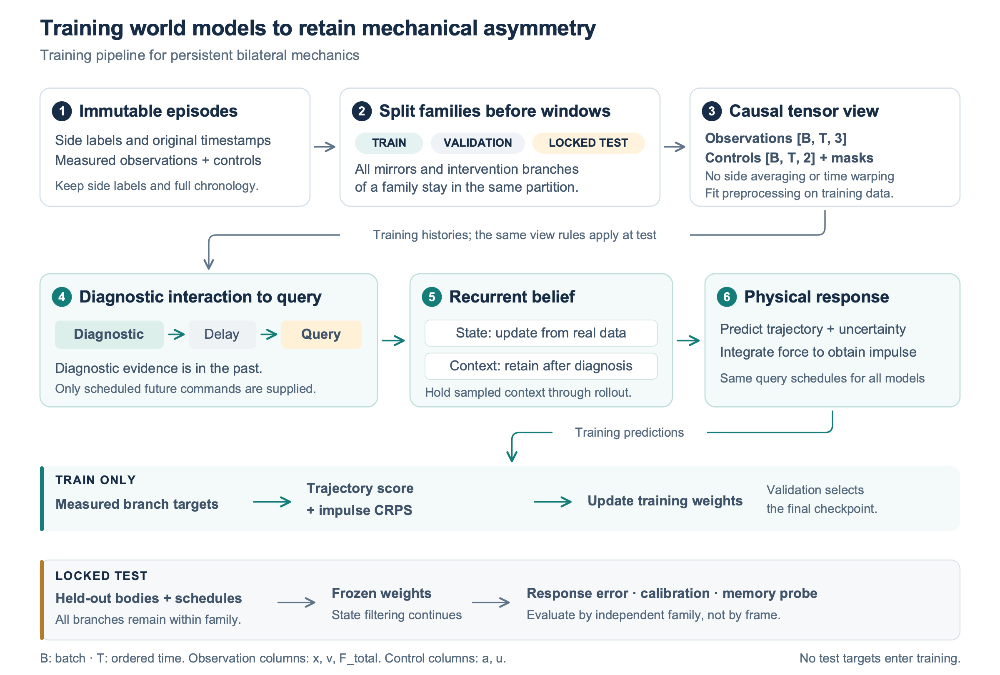

# Research review and seven proposal revisions

**Formatted reading copies:** [Open the seven-version reading index](rendered/index.html) for offline HTML and PDF editions. These editions typeset the equations and embed the pipeline artwork. See the [rendering repair and verification report](rendering/README.md).

Start with the [final proposal](../../notes/archive/ideas-codex/v07_predictive_memory_for_asymmetric_mechanics.md), then read the [scorecard](scorecard.md) and [revision ledger](revision-ledger.md). The seven versions form a successive critique-and-revision sequence; earlier versions remain available so the reasoning can be inspected.

The central research question is whether a predictive model retains identifiable information about asymmetric mechanics and uses it for a later physical response. The final design distinguishes a lack of information in the observations, a change in how information is encoded, limited readout access, and an actual loss of useful prediction. Its strongest alternatives include ordinary identification and simply storing a diagnostic summary. The proposed method must earn its claim against those comparisons.

## Proposals and independent reviews

| Version | Main change | Proposal | Review |
|---|---|---|---|
| Original | Supplied proposal assessed before revision | Original PDF recorded in the source manifest | [Original review](review-v00-original.md) |
| 1 | Focus on mechanical memory rather than a broad analogy | [From restoration to mechanical memory](../../notes/archive/ideas-codex/v01_from_pose_restoration_to_mechanical_memory.md) | [Review 1](review-v01.md) |
| 2 | Separate observable evidence from its later retention | [Observability before memory](../../notes/archive/ideas-codex/v02_observability_before_memory.md) | [Review 2](review-v02.md) |
| 3 | Specify a reflection-consistent uncertain context | [A belief that can remain uncertain](../../notes/archive/ideas-codex/v03_a_parity_consistent_belief_that_can_remain_uncertain.md) | [Review 3](review-v03.md) |
| 4 | Make dynamics, timestamps, branches, and splits auditable | [Dynamics and data contract](../../notes/archive/ideas-codex/v04_auditable_dynamics_and_data_contract.md) | [Review 4](review-v04.md) |
| 5 | Put the candidate against matched objectives and simple explanations | [Matched objectives and strong baselines](../../notes/archive/ideas-codex/v05_matched_objectives_and_defeating_baselines.md) | [Review 5](review-v05.md) |
| 6 | Lock inference, failures, resources, and the scope of broader claims | [Inference and generality gates](../../notes/archive/ideas-codex/v06_locked_inference_and_generality_gates.md) | [Review 6](review-v06.md) |
| 7 | Integrate the final protocol and resolve remaining interpretation issues | [Predictive memory for asymmetric mechanics](../../notes/archive/ideas-codex/v07_predictive_memory_for_asymmetric_mechanics.md) | [Review 7 and final resolution](review-v07.md) |

## Evidence and research decisions

- [Source evidence audit](source-evidence-audit.md): page-specific analysis of all three supplied PDFs, including the completed results and their limitations.
- [Literature audit](literature-audit.md): verified primary sources, closest prior work, and the claims each source can support.
- [ICML positioning and technique selection](icml-positioning-and-selection.md): what to keep, defer, or reject, and how the paper’s eventual claim should follow the evidence.
- [Seven title options](title-options.md): alternatives selected for different eventual empirical outcomes.
- [Mathematical notes](mathematical-notes.md) and [independent theory review](final-theory-check.md): reflection, identifiability, predictive sufficiency, and the limits of decoder-based evidence.
- [Data fidelity and leakage contract](data-fidelity-and-leakage-contract.md): a stage-by-stage account of preserved structure, allowed transformations, and leakage checks.

## Training-pipeline illustration

The [editable SVG](figures/training-pipeline.svg) is original vector artwork. A [PNG preview](figures/training-pipeline.png) and [caption with alt text](figures/training-pipeline-caption.md) are included. Training and locked testing have separate paths; the figure also distinguishes frozen model weights from continued state filtering.

## Status and reproducibility

The scores assess proposal design, not acceptance probability or model performance. No new neural training, human-data experiment, or contact-system implementation was performed. The [analytical checks](checks/README.md) validate only the stated algebra and a toy noise calculation. The [source manifest](source-manifest.json) records the source PDFs and hashes; [artifact validation](artifact-validation.json) records document checks, local links, and scoring arithmetic.

The requested `codex:adversarial-review` capability was unavailable. Independent Codex reviewer agents performed the reviews as a documented substitute; see the [review protocol](review-protocol.md). The current folders are `notes/archive/ideas-codex/` and `output/research-codex/`; the rendering repair updates links to these locations.
